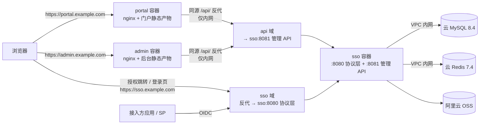

# omino-sso 部署文档

> 适用范围：测试环境、生产环境、本地一体化演示。
> 状态：**方案已落地**（`specs/007-deployment`）。前端镜像、分环境编排、`/api/` 同源反代、健康检查端点、可信代理配置均已具备；`scripts/smoke-deploy.sh` 可对四域名部署做只读冒烟（对应第 9 节清单）。
> 规范优先级：与 `AGENTS.md` 冲突时以 `AGENTS.md` 为准；部署相关约束见其「技术与接口约束」「非目标」章节。
>
> **2026-10-23 口径修正（重要）**：原方案"三子域"扩为**四域名**：`portal`（门户前端）、`admin`（后台前端，**根路径**）、`api`（管理 API，**仅前端 nginx 可达**）、`sso`（OIDC 端点，给 SP 调用）。浏览器始终只访问 `portal`/`admin`/`sso`，前端 XHR 走**同源** `/api/v1` 由 nginx 反代到 `api` 域，因此**不引入 CORS**。另：admin 去掉 `/admin` 前缀，入口变为 `https://admin.example.com/users`（涉及前端路由代码变更）。

---

## 1. 部署拓扑



**四个域名，各司其职**

| 域名 | 谁访问 | 承载内容 | 后端容器端口 |
|---|---|---|---|
| `portal.example.com` | 员工浏览器 | 门户 SPA + `/api/` 反代 | `sso:8081`（经 `api` 域） |
| `admin.example.com` | 管理员浏览器 | 后台 SPA（**根路径**）+ `/api/` 反代 | `sso:8081`（经 `api` 域） |
| `api.example.com` | **仅**前端 nginx（公网不可达） | `/api/v1/*` 管理 API | `sso:8081` |
| `sso.example.com` | 接入方（SP）+ 浏览器授权跳转 | `/oauth2/*`、`/.well-known/*`、`/login`、`/logout`、`/logged-out` | `sso:8080` |

**关键约定**

- 浏览器只访问 `portal`/`admin`/`sso` 三个 HTTPS 域名；`api` 域与容器端口 `8080/8081` 都不对公网开放。
- 前端的所有 XHR 都是**同源**相对路径 `/api/v1/...`，由各自 nginx 反代到 `api` 域：**不需要 CORS**，后端也没有 CORS 中间件。
- 四个域名同属一个主域（`example.com`），属「跨源但同站」：**不需要** `SameSite=None`，整页跳转（门户 ↔ 后台）天然可用。
- `sso` 域是**唯一** issuer（`OIDC_ISSUER=https://sso.example.com`）；`api` 域不提供任何 OIDC 端点。
- 会话 cookie 由登录接口写入（经前端 nginx 返回，仍落在**前端自己的域名**下），`portal`/`admin`/`sso` 三域共同读取，因此 `COOKIE_DOMAIN` 必须显式设为主域（`.example.com`）；留空（host-only）会导致「门户登录成功、进后台又要登录」。
- `api` 域的存在意义是**收紧暴露面**：`sso` 必须公网可达（给 SP），`:8081` 不能跟着暴露，于是单独一个只在 VPC 内解析的域名承接它。
- `admin` 从根路径托管：入口是 `https://admin.example.com/users`。**没有** `/admin` 前缀（2026-10-23 口径修正，见 `specs/007-deployment` FR-004）。

### 1.1 域名与端口矩阵

| 用途 | 外网地址 | 容器内端口 | 反代规则 |
|---|---|---|---|
| 门户 | `https://portal.example.com` | 80 | `/api/` → `api` 域（内网）；其余 SPA fallback |
| 管理后台 | `https://admin.example.com` | 80 | `/api/` → `api` 域（内网）；其余 SPA fallback（根路径，无 `/admin` 前缀） |
| 管理 API | `http://api.example.com`（**仅内网 DNS，明文**） | 80 | `/api/v1/` → `sso:8081`；公网不可达；不配证书 |
| 身份提供方 | `https://sso.example.com` | 80 | `/oauth2/`、`/.well-known/`、`/login`、`/logout`、`/logged-out` → `sso:8080`；**仅**额外放行 `/healthz`（存活探针），`/readyz` 不放行 |
| 一体化演示（本地） | `http://localhost:8088 / 8090 / 8080` | 见第 7 节 | 单机 compose，共用 `localhost` 主机名；前端直接反代 `sso:8081` |

> 反代目标必须**可配置注入**（如 nginx 模板变量 `API_UPSTREAM`）：一体化 compose 用服务名 `http://sso:8081`，test/prod 用内网地址 `http://api.example.com`（或内网 LB）。不要把域名写死进镜像。

---

## 2. 部署产物清单

| 产物 | 路径 | 状态 |
|---|---|---|
| 后端镜像定义 | `Dockerfile` | 已具备（多阶段、非 root、仅含 `verify-mail.tmpl`） |
| 一体化编排 | `docker-compose.yml`（mysql + redis + sso + portal + admin） | 已具备 |
| 测试环境编排 | `deploy/compose.test.yml` | 已具备 |
| 生产环境编排 | `deploy/compose.prod.yml` | 已具备 |
| 环境变量模板 | `deploy/env/test.env.example`、`deploy/env/prod.env.example` | 已具备 |
| 前端镜像与 nginx 配置 | `web/Dockerfile`（portal/admin 双 target）、`web/nginx/portal.conf`、`web/nginx/admin.conf`、`web/nginx/api.conf`（api + sso 域 server 块；前者仅内网） | 已具备 |
| 前端反代模板 | `web/nginx/templates/*.conf.template` 中的 `API_UPSTREAM`（一体化 `http://sso:8081`，test/prod 内网 api 域）；`web/nginx/{portal,admin}.conf` 是指向模板的链接，内容不重复 | 已具备 |
| 前端构建期配置模板 | `web/{portal,admin}/.env.{example,test.example,production.example}`（`VITE_ADMIN_HOME`、`VITE_PORTAL_HOME`、`VITE_PORTAL_LOGIN_URL` 的四域绝对地址）+ `make build-web WEB_MODE=test` | 已具备（`web/portal/src/utils/redirect.ts` 对 `next` 做 origin 白名单校验） |
| admin 根路径化 | `web/admin/src/{router.ts,layouts/AdminLayout.vue,views/Offline.vue,views/client/ClientDetail.vue}` 去 `/admin` 前缀 | 已具备（路由 `/users`、`/clients`…；dev 5174 与 test/prod 一致） |
| 健康检查端点 | `GET /healthz`（存活，公网仅在 `sso` 域放行）、`GET /readyz`（MySQL+Redis，仅容器内/内网） | 已具备（`:8080`、`:8081` 各自提供，绕过限流） |
| 可信代理配置 | `TRUSTED_PROXIES` | 已具备（Gin 与协议层共用一套判定） |
| 迁移文件 | `migrations/*.up.sql` / `*.down.sql` | 已具备（手动执行） |

**基础镜像基线**（部署工具链，不进 `AGENTS.md` §2.1/§2.2 依赖表；锁大版本、构建可复现）：

| 用途 | 基础镜像 | 说明 |
|---|---|---|
| 后端构建 | `golang:1.26-alpine` | 与 `go.mod` 的 `go 1.26.0` 对齐 |
| 后端运行 | `alpine:3.20` | 非 root（UID 10001），仅含二进制 + 邮件模板 |
| 前端构建 | `node:22-alpine` | 当前 LTS；只在构建阶段存在，不进运行镜像 |
| 前端运行 | `nginx:1.27-alpine` | 稳定主线；自带 `/docker-entrypoint.d/20-envsubst-on-templates.sh` |
| 本地依赖 | `mysql:8.4`、`redis:7.4-alpine` | 与 §2.3 一致（test/prod 用云实例，编排里不含它们） |

---

## 3. 环境准备

1. **DNS**：为四个子域（`portal` / `admin` / `api` / `sso`）配置 A/CNAME 指向负载均衡或宿主机。
2. **证书**：在负载均衡或宿主机 nginx 终止 TLS，准备上述四个域名的证书（可用同一张通配符证书）。
3. **数据库**：云 MySQL 8.4，字符集 `utf8mb4`，排序规则 `utf8mb4_0900_ai_ci`；创建独立库（如 `omino_sso`）与最小权限账号。
4. **缓存**：云 Redis 7.4，单实例；设置密码并通过 VPC/白名单限制来源（**不启用 TLS**）。
5. **对象存储**：阿里云 OSS bucket + STS AssumeRole 角色（RAM 用户长期 AK 仅用于 AssumeRole）。
6. **通知通道**：SMTP 账号（`MAIL_*`）、创蓝短信（`SMS_*`）；测试环境可保留 `mock`，**生产禁止 mock**（启动即失败）。
7. **密钥材料**：RSA 签名私钥（PEM，权限 `0600`）、`OIDC_CRYPTO_KEY`（32 字节）；通过挂载或密钥管理注入，**不得**提交仓库、不得打进镜像。

---

## 4. 配置

### 4.1 后端（运行时环境变量，`APP_ENV=test|prod`）

| 变量 | 说明 | 生产示例 |
|---|---|---|
| `APP_ENV` | `prod` 触发严格校验（issuer 必须 https、cookie 必须 Secure、禁止 mock 通道） | `prod` |
| `OIDC_ISSUER` | 必须与外部访问地址**完全一致**（含协议，不含尾斜杠） | `https://sso.example.com` |
| `OIDC_SIGNING_KEY_PATH` | 私钥挂载路径 | `/run/secrets/signing-key.pem` |
| `OIDC_SIGNING_KEY_ID` | `kid`，轮换时递增 | `2026-10` |
| `OIDC_CRYPTO_KEY` | 32 字节密钥（原始字符或 base64） | 由密钥管理注入 |
| `COOKIE_DOMAIN` | **必须是主域（`.example.com`）**，且必须是显式的 Domain 属性：cookie 由前端域写入、需被 `portal`/`admin`/`sso` 三域共同读取，host-only 会让 SSO 失效 | `.example.com` |
| `COOKIE_SECURE` | 生产必须 `true` | `true` |
| `COOKIE_SAME_SITE` | 同站子域用 `Lax`（不需要 `None`；本项目无跨源 XHR） | `Lax` |
| `DB_HOST` / `DB_PORT` / `DB_USER` / `DB_PASSWORD` / `DB_NAME` | 云 MySQL（VPC 内网） | `rm-xxx.mysql.rds.aliyuncs.com:3306` |
| `DB_MAX_OPEN_CONNS` / `DB_MAX_IDLE_CONNS` / `DB_CONN_MAX_LIFETIME` | 连接池（按云实例规格调整） | `25 / 10 / 30m` |
| `REDIS_ADDR` / `REDIS_PASSWORD` / `REDIS_DB` | 云 Redis（内网、无 TLS） | `r-xxx.redis.rds.aliyuncs.com:6379` |
| `TRUSTED_PROXIES`（待实现） | 可信反代网段（CIDR，逗号分隔）；仅这些来源的 `X-Forwarded-*` 被采信 | `10.0.0.0/8,172.16.0.0/12` |
| `MAIL_*` / `SMS_*` / `OSS_*` | 通道与对象存储 | 见 `.env.example` |

> 后端**没有** CORS 配置项，也不需要：前端所有请求同源，跨源只发生在服务端（nginx → `api` 域）。

> 完整清单与默认值以 `AGENTS.md` §9 与 `.env.example` 为准。新增变量必须同步三处（代码、`.env.example`、AGENTS），否则 `make check` 会失败。

### 4.2 前端（构建期 `VITE_*`，按环境构建镜像）

| 参数 | 作用 | test 示例 | prod 示例 |
|---|---|---|---|
| `VITE_API_BASE_URL` | 管理 API 基地址；**保持同源相对值 `/api/v1`**（由 nginx 反代），不需要按环境改 | `/api/v1` | `/api/v1` |
| `VITE_ADMIN_HOME` | 门户登录后跳转的后台地址（admin 根路径） | `https://admin.test.example.com/` | `https://admin.example.com/` |
| `VITE_PORTAL_HOME` | 后台会话失效时「返回门户」地址 | `https://portal.test.example.com/account/profile` | `https://portal.example.com/account/profile` |
| `VITE_PORTAL_LOGIN_URL` | 后台未登录时跳转的登录页 | `https://portal.test.example.com/login` | `https://portal.example.com/login` |
| `VITE_SITE_NAME` | 站点名 | `统一身份认证（测试）` | `统一身份认证` |

> 归属关系：`VITE_ADMIN_HOME` 只被 **portal** 使用；`VITE_PORTAL_HOME` / `VITE_PORTAL_LOGIN_URL` 被 **admin**（回跳门户）与 portal 自身使用。缺省值只适用于本地开发，跨域名部署必须显式设置后三项。

> 只有 `api` 域的反代目标随环境变（`API_UPSTREAM`），这个不是前端构建参数，见 §1.1 与 §5。

> 地址形态一律是**域名根**（`https://admin.example.com/`），不要再拼 `/admin/`；`VITE_ADMIN_HOME` 由 portal 整页跳转使用，admin 侧的深链由 admin 自己的路由处理。

### 4.3 密钥与配置文件管理

- 仓库提供 `.example` 模板；真实文件放在服务器 `/etc/omino-sso/{test,prod}.env` 或密钥管理系统，权限 `0600`，属主为部署账号。
- compose 使用 `env_file: /etc/omino-sso/prod.env`；签名私钥以只读卷挂载，`OIDC_SIGNING_KEY_PATH` 指向容器内路径。
- 轮换 `OIDC_CRYPTO_KEY` 会导致库内加密字段（如 TOTP 密钥）不可解密，必须单独评审并走数据迁移方案。

---

## 5. 镜像构建

**一条命令构建三镜像**（推荐；前端绝对地址由 `DOMAIN` 派生，不用手抄 build-arg）：

```bash
make images DOMAIN=example.com IMAGE_TAG=2026.10.23-1
# → registry.example.com/omino-sso:2026.10.23-1
#   registry.example.com/omino-portal:2026.10.23-1
#   registry.example.com/omino-admin:2026.10.23-1

make image-check DOMAIN=example.com FOREIGN_DOMAIN=example-test.com IMAGE_TAG=2026.10.23-1
make image-push  REGISTRY=registry.example.com IMAGE_TAG=2026.10.23-1
```

可覆盖的变量：`REGISTRY`（默认 `registry.example.com`）、`SITE_NAME`、以及 `ADMIN_HOME` / `PORTAL_HOME` / `PORTAL_LOGIN_URL`（默认按 `DOMAIN` 生成 `https://admin.<主域>/`、`https://portal.<主域>/account/profile`、`https://portal.<主域>/login`）。缺 `IMAGE_TAG` 或 `DOMAIN` 时目标直接失败并说明原因。

**等价的手工命令**（`make` 不可用时照此执行，语义与上面三条一致）：

```bash
# backend（已具备）
docker build -t registry.example.com/omino-sso:2026.10.23-1 .

# portal（按环境注入 VITE_*；构建上下文是 ./web，不是仓库根）
docker build -f web/Dockerfile \
  --target portal \
  --build-arg VITE_ADMIN_HOME=https://admin.example.com/ \
  --build-arg VITE_PORTAL_HOME=https://portal.example.com/account/profile \
  --build-arg VITE_PORTAL_LOGIN_URL=https://portal.example.com/login \
  --build-arg VITE_SITE_NAME="统一身份认证" \
  -t registry.example.com/omino-portal:2026.10.23-1 ./web

# admin（同上，另一个 target）
docker build -f web/Dockerfile \
  --target admin \
  --build-arg VITE_PORTAL_HOME=https://portal.example.com/account/profile \
  --build-arg VITE_PORTAL_LOGIN_URL=https://portal.example.com/login \
  --build-arg VITE_SITE_NAME="统一身份认证" \
  -t registry.example.com/omino-admin:2026.10.23-1 ./web
```

> `VITE_API_BASE_URL` 不传，取代码内默认 `/api/v1`（同源）。两个域名的反代目标 `API_UPSTREAM` 属于**运行时**配置，在编排里注入，不进镜像。
>
> 构建上下文裁剪由 `web/.dockerignore` 负责（排除 `node_modules`、旧 `dist`、本地 `.env*`），因此宿主机的残留产物不会串进镜像。`web/Dockerfile` 的 portal target 缺少 `VITE_ADMIN_HOME`、admin target 缺少 `VITE_PORTAL_HOME`/`VITE_PORTAL_LOGIN_URL` 时**构建即失败**（避免产出“跳到错误环境”的镜像）。
>
> `web/nginx/api.conf`（api + sso 域）**不进前端镜像**：它部署在入口 nginx / 宿主机 nginx 上，不含 `${API_UPSTREAM}`，也不是 SPA 容器的一部分。

**标签规范**：`<版本或日期>-<序号>`（如 `2026.10.23-1`），测试与生产可共用同一 tag；**后端三镜像 tag 必须一致**，便于回滚时成套切换。

**构建前置检查**（本地或跳板机）：

```bash
make docs-check   # 文档与注解不漂移
make check        # 路由/错误码/审计/环境变量 + 文档命令 + openapi 基线 sha256 + 串环境（未给镜像则 skip）
```

**构建后自检**（只读，幂等）：`make image-check DOMAIN=<主域> FOREIGN_DOMAIN=<另一环境主域> IMAGE_TAG=<tag>`，等价于下面三步：

```bash
# 1. 配置可解析（模板在容器启动时才渲染，因此这里只验证 nginx 自身）
docker run --rm registry.example.com/omino-portal:<tag> nginx -t
docker run --rm registry.example.com/omino-admin:<tag>  nginx -t

# 2. 镜像内不得残留官方 default.conf（否则它是 80 端口默认 server，全站 404）
docker run --rm --entrypoint sh registry.example.com/omino-portal:<tag> -c 'ls /etc/nginx/conf.d'

# 3. 串环境检查：读镜像内产物，断言不含另一环境的域名
PORTAL_IMAGE=registry.example.com/omino-portal:<tag> \
ADMIN_IMAGE=registry.example.com/omino-admin:<tag> \
EXPECT_DOMAIN=example.com FOREIGN_DOMAIN=example-test.com \
  ./scripts/check-build-env.sh
```

> `VITE_*` 是**构建期**变量，域名会作为字符串进入 JS 产物（这是设计如此，不是泄漏）；"镜像内不含环境域名"指的是 nginx 配置，`grep -r example.com web/nginx/` 必须 0 命中。

---

## 6. 数据库迁移（运维手动执行）

> 应用启动**不会**自动迁移；`0002` 起为裸 `ALTER`，**不幂等**，重复执行会失败。

**首次部署**

1. 备份空库基线（可选）。
2. 按文件名升序执行全部 `migrations/*.up.sql`：

   ```bash
   DB_HOST=<云实例> DB_PORT=3306 DB_USER=<user> DB_PASSWORD=<pwd> DB_NAME=omino_sso make migrate-up
   ```

3. 核对表结构：`SHOW TABLES;`、`SHOW COLUMNS FROM client_members LIKE 'is_admin';`。
4. 记录本次执行的最后一个文件（建议维护 `schema_history` 表或在发布单登记）。

**版本升级**

1. 全量备份：`mysqldump --single-transaction ... > backup-$(date +%F-%H%M).sql`。
2. 只执行**新增**的迁移文件（与登记记录对比），逐条确认 `Rows affected`/无报错。
3. 记录执行人、时间、文件列表。

**失败与回滚**

- 单个 `ALTER` 失败：先确认是否已部分生效（MySQL 8 `ALTER` 多为原子），再决定重试或按 `*.down.sql` 逆序回退。
- 回退脚本会丢列/丢数据，执行前必须再备份；生产回退需评审。

**当前迁移清单**：`0001_init`、`0002_clients_meta`、`0003_app_auth`、`0004_*`、`0005_verification_auth`、`0006_app_admin_role`（以目录实际文件为准）。

---

## 7. 启动

### 7.1 测试 / 生产（外部云 DB/Redis）

```bash
docker compose -f deploy/compose.prod.yml --env-file /etc/omino-sso/prod.env up -d

# 验证
docker compose -f deploy/compose.prod.yml ps
curl -fsS https://sso.example.com/.well-known/openid-configuration | head -c 200
```

编排应包含：`sso`（一个容器，暴露 `:8080` 与 `:8081`）、`portal`、`admin` 三个服务；不包含 MySQL/Redis；`portal`/`admin` 的 nginx 把 `/api/` 反代到 `API_UPSTREAM`（test/prod 指向内网 `api` 域，`sso` 域只暴露 `:8080`）；健康检查通过后才对外接流量。

### 7.2 本地一体化（含 MySQL/Redis）

```bash
docker compose up -d --build
docker compose ps
```

浏览器访问（浏览器只碰三个端口；`:8081` 仅供容器间使用）：

- 门户：`http://localhost:8088`（页面内 `/api/` 由自身 nginx 反代到 `sso:8081`）
- 后台：`http://localhost:8090/users`（根路径，无 `/admin`；同上反代）
- IdP：`http://localhost:8080`（本地 HTTP 需 `COOKIE_SECURE=false`，`APP_ENV=dev`，`COOKIE_DOMAIN` 留空）
- 管理 API：`http://localhost:8081/api/v1`（调试用，浏览器页面不直连）

本地要点：

- 三个端口共用 `localhost` 主机名，cookie 不区分端口，因此 `COOKIE_DOMAIN` 留空也能共享会话；**不要**为本地配 `.localhost`。
- 本地也走**同源反代**（`API_UPSTREAM=http://sso:8081`），与线上形态一致，因此完全不需要 CORS。
- 端口分配以 `docker-compose.yml` 的 `${*_HOST_PORT}` 变量为准。

### 7.3 入口 nginx 落地（`api` 与 `sso` 域）

`api` 域与 `sso` 域**不在容器里**：两者都由 `web/nginx/api.conf` 提供，部署在入口 LB 后面的宿主机 nginx 上（`portal`/`admin` 的静态与反代已经在前端镜像里，不需要这一步）。

1. **放置配置**（不要和 `/etc/nginx/conf.d/default.conf` 抢默认 server）：

   ```bash
   sudo install -m 644 web/nginx/api.conf /etc/nginx/conf.d/omino-sso.conf
   ```

2. **按文件头的「部署前必须替换」清单改三处**：
   - `server_name _;`（两处）→ 与其它站点共用同一 nginx 时改成 `api.example.com` / `sso.example.com`；独占一台入口 nginx 可保留 `_`，但同一端口只能有一个 `_` 默认 server。
   - `ssl_certificate` / `ssl_certificate_key` → 实际证书路径（默认写的是 `/etc/nginx/tls/sso.crt|key`）。
   - `proxy_pass http://sso:8081`（与 `:8080`）→ 入口 nginx **不在 compose 网络**时改成可达地址：同机用 `127.0.0.1:8081` / `127.0.0.1:8080`（编排里这两个端口只绑回环），跨机用内网 IP 或内网 LB。

3. **证书**（`portal`/`admin`/`sso` 可共用一张通配符证书；`api` 域**不配证书**）：

   ```bash
   sudo install -d -m 700 /etc/nginx/tls
   sudo install -m 400 fullchain.pem /etc/nginx/tls/sso.crt
   sudo install -m 400 privkey.pem   /etc/nginx/tls/sso.key
   ```

4. **校验并生效**：`sudo nginx -t && sudo nginx -s reload`。

5. **验证四域暴露面**（顺序别换，先内网后公网）：

   ```bash
   curl -fsS -o /dev/null -w 'sso/healthz=%{http_code}\n' https://sso.example.com/healthz        # 200
   curl -s   -o /dev/null -w 'sso/readyz=%{http_code}\n'  https://sso.example.com/readyz         # 404
   curl -s   -o /dev/null -w 'api/me(内网)=%{http_code}\n' http://api.example.com/api/v1/me      # 401
   # 在公网机器执行：必须连接失败（DNS 不解析或安全组拒绝）
   curl -m 5 -sS http://api.example.com/api/v1/me
   ```

> 两条不能删的配置：`api` 域不配 `ssl_certificate`（内网明文，证书不覆盖它）；`sso` 域的 `X-Forwarded-Proto $scheme`（缺了会让 OIDC issuer 校验与授权回跳协议出错）。
> 若 `/api/*` 返回 502：先 `getent hosts api.example.com` 看解析，再在容器内 `curl -s -o /dev/null -w '%{http_code}' http://sso:8081/healthz` 直连兜底（见 §11）。

### 7.4 本地命令启动（保持可用）

```bash
make dev                      # 后端 go run（:8080 协议 + :8081 API）
cd web/portal && npm run dev  # 门户 5173，/api 由 vite 代理到 :8081（同源，不需要 CORS）
cd web/admin  && npm run dev  # 后台 5174，同上
```

---

## 8. 升级与回滚

**升级**

1. 构建/拉取三镜像（同 tag）。
2. 执行增量迁移并记录。
3. `docker compose ... up -d` 替换容器（单副本，短暂停机）。
4. 跑第 9 节验收清单。

**回滚**

1. 代码回滚用**旧 tag** 重新 `up -d`（镜像留旧 tag 是硬要求）；目标：**三容器 5 分钟内恢复 healthy 且 admin 可登录**（SC-008）。
2. 数据回滚仅在必须时进行：停服 → 恢复备份 → 起旧镜像；数据库结构回退优先用 `*.down.sql`，并确认无数据依赖。

**触发回滚的判定条件**（发布后 15 分钟内出现任一即回滚，不临时讨论）：

- `https://sso.<主域>/healthz` 连续 2 分钟非 200，或三容器中任一处于 `unhealthy`；
- 登录接口 5xx 比例 > 1%（以入口 nginx access log 计）；
- 门户/后台出现"登录成功但立即 401"（多为 cookie/SameSite 回归）；
- 审计日志出现 `audit_events.ip` 全为容器网段（多为 `TRUSTED_PROXIES` 漏配）。

---

## 9. 部署后验收清单

- [ ] **发布前本地预演**：`make e2e` 全绿（四域 HTTPS 下验证跨子域 SSO、cookie 属性与失效、探针暴露面、多跳 XFF，41 项断言；需 docker，见 `scripts/e2e/run.sh` 头部说明）
- [ ] **只读冒烟一次跑完**：`DOMAIN=example.com ./scripts/smoke-deploy.sh` 全绿（探针暴露面、公网 `api` 域不可达、容器内 `/docs` 404、深链 200 且 `no-store`、指纹资源 `immutable`、portal 同源反代 401）；公网机器执行，内网跳板机会把第 3 条跑成假红
- [ ] 三容器健康：容器内 `curl 127.0.0.1:8080/healthz`、`8081/healthz` 均 200；容器内 `/readyz` 200（DB/Redis 均通）
- [ ] 探针暴露面：`https://sso.example.com/healthz` 200，`https://sso.example.com/readyz` 404
- [ ] `sso.example.com/.well-known/openid-configuration` 的 `issuer` 与外网地址完全一致（`api` 域不得返回该文档）
- [ ] 门户登录成功，cookie 带 `Secure`、`HttpOnly`、`SameSite=Lax`；`Domain` 实际输出为 `example.com`（配置写 `COOKIE_DOMAIN=.example.com`，Go 按 RFC 6265 省略前导点，语义等价，**不要按字面 grep `.example.com`**）
- [ ] 打开 `admin.example.com/users` 不需要二次登录，地址栏**无** `/admin` 前缀
- [ ] 浏览器网络面板：所有 `/api/v1/*` 请求都是**当前域名的相对路径**，无 `OPTIONS` 预检（同源反代生效）
- [ ] 公网 `curl http://api.example.com/api/v1/me`（及 `https://`）均连不通（`api` 域只在 VPC/内网解析）
- [ ] 后台会话失效 → 门户登录 → 回到 admin 原路径
- [ ] 主动登出后落到 `https://portal.example.com/login?loggedOut=1`（显示"已退出"，参数被清），且再访问 `admin` 域要求重新登录
- [ ] 凭原密码改密后旧 `sid` 立即失效（`/api/v1/me` 返回 401），响应 `Set-Cookie` 带 `Domain=example.com` + `Max-Age=0`（与登录时同一 Domain）
- [ ] 凭验证码重置密码（`/me/password/reset`）后**当前会话仍有效**、其他设备失效（与改密语义不同，别合并验证）
- [ ] 第三方应用 OIDC 授权码流程可完成（`redirect_uri` 已在应用配置中登记）
- [ ] `admin.example.com/clients/<id>/members` 直接刷新不 404
- [ ] 审计日志中的客户端 IP 为真实 IP，限流按真实来源生效。抽样 20 条（SC-004）：

  ```sql
  SELECT ip, COUNT(*) AS n
  FROM audit_events
  WHERE created_at >= (UNIX_TIMESTAMP() - 3600) * 1000
  ORDER BY created_at DESC
  LIMIT 20;
  ```

  判定：`ip` 必须是你自己的公网 IP；出现 `172.x` / `10.x` / `127.0.0.1` 说明 `TRUSTED_PROXIES` 漏配某一段
  （反证方法：临时去掉前端容器网段，登录一次后重查，IP 应变成容器网段，验证完加回）。
- [ ] Logo/头像上传成功（OSS STS 正常）
- [ ] 验证码邮件/短信可发送（通道非 mock）
- [ ] 门户、后台深链刷新不 404；静态资源哈希更新后不引用旧文件

---

## 10. 安全清单

- [ ] 仅 443 对外；`8080/8081` 不对公网开放
- [ ] TLS 1.2+；开启 HSTS（确认全站 HTTPS 后再开）
- [ ] cookie：`Secure` + `HttpOnly` + `Domain=主域`（配置 `.example.com`，响应头输出 `example.com`，非 host-only）+ `SameSite=Lax`
- [ ] `api` 域只在 VPC/内网解析，公网 0 次可达 —— 注意它是"唯一命名入口"，**隔离本身由内网 DNS + 安全组/网络 ACL 强制**（容器内 `:8081` 对同网络服务仍可达），不得以域名存在与否作为安全验收依据
- [ ] 健康探针：公网只有 `sso` 域的 `/healthz`，`/readyz` 公网 404（不泄露依赖状态）
- [ ] `api` 域不暴露 `/docs`（prod 已 404）、不暴露 OIDC 端点；`sso` 域不暴露 `/api/v1`
- [ ] 签名私钥 `0600`、非 root 运行（镜像已用 UID 10001）
- [ ] 前端镜像内不含环境域名：`docker history registry.example.com/omino-portal:<tag> | grep -i example.com` 无命中（域名只来自构建参数与运行时 `API_UPSTREAM`）
- [ ] 数据库账号最小权限；Redis 密码 + 白名单
- [ ] `APP_ENV=prod` 且短信/邮件非 mock；`/docs` 在 prod 自动 404（已具备）
- [ ] nginx 限制请求体大小与超时，隐藏版本号
- [ ] 密钥轮换有记录；`OIDC_CRYPTO_KEY` 不随意更换

---

## 11. 常见故障排查

| 现象 | 排查顺序 |
|---|---|
| 页面所有 API 请求 502 / `connect() failed` | ① 前端 nginx 的 `API_UPSTREAM` 是否指向可达地址（一体化应为 `http://sso:8081`）② 容器内 `getent hosts api.example.com` 是否能解析 ③ 反代是否漏了 `proxy_set_header Host` ④ 目标端口是否写错（`8081` 不是 `8080`） |
| 前端请求带 `https://api.example.com` 导致 CORS 报错 | 构建时误传了 `VITE_API_BASE_URL` 绝对地址；该值必须保持 `/api/v1`，否则退回跨源形态（本项目不提供 CORS） |
| 登录接口 200 但之后一直 401（刷新即掉线） | ① `COOKIE_DOMAIN` 是否被留空（host-only） ② 浏览器 cookie 面板确认 Domain 是 `.example.com` ③ `COOKIE_SECURE` 与实际协议是否匹配 |
| 门户已登录，admin 域仍跳登录 | ① `COOKIE_DOMAIN` 是否为主域（`.example.com`）② 浏览器 cookie 面板确认域与 `Secure` ③ 两个前端是否都反代到同一个 backend（`sso:8081`） |
| 后台登录后停在门户域名 | ① `VITE_PORTAL_LOGIN_URL` 是否为绝对地址 ② 门户登录页的 `next` 白名单是否包含 admin 主机 ③ 后台 `VITE_PORTAL_HOME` 是否正确 |
| 访问 `admin.example.com/users` 白屏或 404 | ① admin 镜像是否按**根路径**构建（`vite base='/'`）② 路由是否已去掉 `/admin` 前缀 ③ nginx 是否做了 SPA fallback ④ `VITE_ADMIN_HOME` 是否仍写着 `/admin/users` |
| OIDC 报 `redirect_uri` 不匹配 | ① `OIDC_ISSUER` 是否与访问地址一致 ② 应用登记的 `redirect_uris` 是否含当前环境 ③ 是否经代理改写了 Host/Proto |
| 全站 429 / 限流异常 | ① `TRUSTED_PROXIES` 是否包含反代网段 ② nginx 是否透传 `X-Forwarded-For` ③ 审计 IP 是否为代理地址 |
| 审计里 IP 都是 127.0.0.1/内网 | 同上；确认反代与 `TRUSTED_PROXIES` |
| 上传 Logo/头像失败 | ① OSS 配置四项是否齐全 ② STS AssumeRole 角色与权限 ③ bucket CORS/跨域设置 |
| 启动即退出并提示缺失变量 | 按日志补齐 `OIDC_ISSUER`/`COOKIE_*`/`DB_*`/`REDIS_*`；生产检查是否误用 mock 通道 |
| `/readyz` 不通过 | 依次 `mysqladmin ping`、`redis-cli -a ... ping`、检查安全组/白名单 |
| 后台刷新 404 | nginx 缺少 SPA fallback（`try_files $uri /index.html`） |
| 前端容器反复重启、日志提示 `host not found in upstream` | nginx 在**启动时**解析 `proxy_pass` 主机名：确认 `api` 域在本机能解析（容器内 `getent hosts api.example.com`）、后端已 healthy，并检查 `depends_on`/`restart` 策略 |
| 前端容器一直 `unhealthy` 但页面能打开 | 容器 healthcheck 打自身 `/healthz`，conf 里缺 `location = /healthz { return 200 "ok"; }` |
| 前端容器 `Up` 但**所有页面 404**（含 `/healthz`） | 镜像内残留官方 `/etc/nginx/conf.d/default.conf`（`server_name localhost`，是 80 端口的默认 server，抢走了全部流量）。运行阶段必须 `RUN rm -f /etc/nginx/conf.d/default.conf`；自检：`docker run --rm <镜像> ls /etc/nginx/conf.d` 不应出现 `default.conf` |
| 前端容器启动即退出，日志 `unknown "api_upstream" variable` | 未注入 `API_UPSTREAM`：模板变量没被替换，nginx 把 `${API_UPSTREAM}` 当变量名解析。检查编排 `environment` 与 `--env-file` 是否带上该键 |
| 升级后页面白屏/资源 404 | `index.html` 被缓存；确认 `index.html` 不缓存、静态资源带 hash 长缓存 |

---

## 12. 与规范的关系

- 本文件是运维执行手册；接口、错误码、环境变量的**权威清单**在 `AGENTS.md`。
- 需求与验收项见 `specs/007-deployment/spec.md`；实现完成后同步更新 `AGENTS.md` 的部署拓扑（§8.6）、基础设施（§2.3）、环境变量（§9，`COOKIE_DOMAIN` 示例改为 `.example.com`）与目录结构（§3）。
- 部署形态变化（四域名、按环境构建、云 DB/Redis、`api` 域内网化）需要在 `AGENTS.md` 中登记后再落代码，避免「代码先行、规范滞后」。
- 本次口径修正涉及代码的实现项（不在本文件展开）：`web/admin` 路由/菜单/tab/离线页去 `/admin` 前缀；`/healthz`、`/readyz`；`TRUSTED_PROXIES`。**后端不新增 CORS 能力**。
