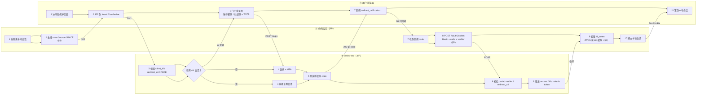
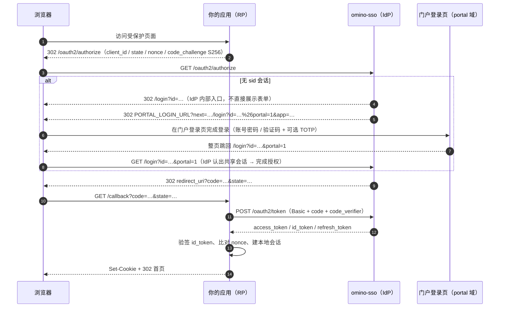

# 应用接入指南（OIDC）

> 适用对象：Java / Python / Go 等任意语言的业务系统接入 omino-sso 统一身份。
> 协议：OIDC Authorization Code + PKCE（仅 S256）。不提供 implicit / password / 设备码。

## 术语与缩写

先扫一遍这张表再读正文；后文首次出现时只给一句提示，不重复展开。

| 术语 | 全称 / 读法 | 含义 |
|---|---|---|
| **IdP** | Identity Provider，身份提供方 | 本文指 omino-sso 本身：负责登录、签发令牌、维护登录会话 |
| **RP** | Relying Party，依赖方 | 接入方系统（你的 Java / Python / Go 应用），依赖 IdP 完成认证 |
| **OIDC** | OpenID Connect | 架在 OAuth 2.0 之上的认证层，用 `id_token` 回答「这个用户是谁」 |
| **授权码** | authorization code | IdP 经浏览器发给 RP 的一次性短命凭据，只能换一次令牌 |
| **PKCE** | Proof Key for Code Exchange | 用 `code_verifier` / `code_challenge` 证明「换令牌的人就是发起授权的人」，防授权码被截获后冒用 |
| **S256** | SHA-256 | PKCE 的挑战算法：`BASE64URL(SHA256(code_verifier))`；本 IdP **只接受这一种** |
| **state** | — | RP 生成、回调时回查的随机串，防 CSRF 与响应错配 |
| **nonce** | — | RP 生成、IdP 原样写入 `id_token` 的随机串，防 `id_token` 重放 |
| **id_token** | — | JWT，回答「是谁」，含 `sub` / `nonce` / `auth_time` / 自定义声明 |
| **access_token** | — | JWT，回答「能访问什么」，用于调 `userinfo` 与业务接口 |
| **refresh_token** | — | 不透明串，用于续期；**每次使用都会轮换** |
| **JWT / JWS** | JSON Web Token / Signature | 点分三段、RS256 签名的令牌格式 |
| **JWKS** | JSON Web Key Set | 公钥集端点，RP 用它验签，须按 `kid` 缓存 |
| **issuer** | — | IdP 的唯一标识 URL（如 `https://sso.example.com`），所有令牌的 `iss` 都等于它 |
| **scope** | — | 申请访问的范围：`openid` / `profile` / `email` / `offline_access` |
| **成员** | membership | 应用与用户之间的授权关系；用户只有在某应用成员中，门户才展示该应用，且 userinfo 才会给 `app_roles` / `permissions` |
| **应用内角色** | app role | 某个应用自己的角色（如 `opsAdmin`），仅在该应用内生效，与平台 `roles` 无关 |
| **权限** | permission | 挂在应用内角色下的功能编码（如 `order:read`），经 userinfo 的 `permissions` 数组下发给接入方 |
| **claim** | — | 令牌里的字段，如 `sub`、`tenant`、`roles` |
| **sid** | session id | IdP 侧会话 cookie 名（`HttpOnly` + host-only），浏览器不会把它发给 RP |
| **MFA / TOTP** | 多因素认证 / 时间型一次性密码 | 登录第二步的 6 位动态码，由 IdP 负责，RP 无感 |
| **amr** | authentication methods references | 令牌里记录本次认证方式：`pwd` / `otp` |
| **SSO / SLO** | Single Sign-On / Single Logout | 一次登录处处通行 / 一处登出使 **IdP 会话**失效（不等于全网广播） |
| **RP 发起登出** | RP-Initiated Logout | RP 引导浏览器调 `/oauth2/end_session` 清 IdP 会话 |
| **DCR** | Dynamic Client Registration | 客户端自助注册协议，本 IdP 未实现 |
| **introspect** | Token Introspection | 把令牌交给 IdP 查询是否有效、属于谁 |

## 0. 前置条件

- omino-sso 已部署，issuer 形如 `https://sso.example.com`（`APP_ENV=prod` 时强制 https）
- 你有管理员账号（可访问 `/api/v1/admin/*` 完成应用注册）
- 你的应用（RP）有浏览器可访问的回调地址，且能保存服务端会话

## 1. 能力边界

| 支持 | 不支持（勿尝试） |
|---|---|
| `authorization_code` + PKCE(S256) | implicit、password、设备码 |
| `refresh_token`（轮换 + 重放检测） | `client_secret_post` |
| `client_secret_basic` | request object（`request` / `request_uri`） |
| `userinfo`、`introspect`、`revoke` | 动态客户端注册（DCR） |
| 单点登录 / RP 发起登出 | 注册 `post_logout_redirect_uri` |
| MFA（由 IdP 负责，RP 无感） | 会话管理 iframe 探测、SAML |
| 应用内角色与权限（userinfo 的 `app_roles` / `permissions`） | 用平台 `roles` 推导应用内权限（两者互不推导，见 §6.1） |

## 2. 端点一览

`issuer` 以 `https://sso.example.com` 为例；各端点也可从 `{issuer}/.well-known/openid-configuration` 自动发现。

| 用途 | 端点 |
|---|---|
| 元数据 | `GET {issuer}/.well-known/openid-configuration` |
| 授权 | `GET {issuer}/oauth2/authorize` |
| 令牌 | `POST {issuer}/oauth2/token`（仅 form-encoded） |
| 用户信息 | `GET {issuer}/oauth2/userinfo`（Bearer） |
| 公钥集 | `GET {issuer}/oauth2/jwks` |
| 自省 | `POST {issuer}/oauth2/introspect`（需客户端认证） |
| 撤销 | `POST {issuer}/oauth2/revoke`（需客户端认证） |
| 登出 | `GET {issuer}/oauth2/end_session` |

### 2.1 授权码流程（泳道图）

三条泳道分别是**用户浏览器**、**你的应用（RP）**、**omino-sso（IdP）**。图中数字是交互顺序，括注对应后文小节。



同一流程的消息视图（顺序更直观，便于对照抓包）：



## 3. 第一步：注册应用

由管理员调用管理 API（需 admin 会话 cookie）：

```bash
curl -b admin.cookie -X POST https://sso.example.com/api/v1/admin/clients \
  -H 'Content-Type: application/json' \
  -d '{
    "clientName": "员工门户",
    "description": "员工自助门户",
    "redirectUris": ["https://portal.example.com/callback"],
    "grantTypes": ["authorization_code", "refresh_token"],
    "scopes": ["openid", "profile", "email", "offline_access"],
    "isPublic": false
  }'
```

| 字段 | 必填 | 说明 |
|---|---|---|
| `clientName` | 是 | 1–128 字符，登录页会显示 |
| `redirectUris` | 是 | 至少一个；**逐字符精确匹配**，建议不带查询串 |
| `grantTypes` | 否 | 省略时为 `authorization_code,refresh_token` |
| `scopes` | 否 | 省略时为 `openid,profile,email,offline_access` |
| `isPublic` | 否 | `true` = 无密钥（SPA / 移动端），必须用 PKCE |

响应中的 `clientSecret` **只出现一次**，不落日志、不可再查；丢失只能轮换：

```bash
curl -b admin.cookie -X POST https://sso.example.com/api/v1/admin/clients/<clientId>/secret
```

默认时效：access_token 900 秒，refresh_token 30 天。

## 4. 第二步：发起授权

本步由**浏览器**完成跳转；你的应用（RP）只负责生成参数，并在自己的会话里暂存 `state` / `nonce` / `code_verifier`
—— 三者回调时都要比对，其中只有 `code_challenge`（= `S256(code_verifier)`）会发给 IdP。

```text
GET {issuer}/oauth2/authorize
  ?response_type=code
  &client_id=<clientId>
  &redirect_uri=<已注册的地址，逐字符一致>
  &scope=openid profile email
  &state=<随机串，回调时校验>
  &nonce=<随机串，用于校验 id_token>
  &code_challenge=<BASE64URL(SHA256(verifier))>
  &code_challenge_method=S256
```

- 未登录时 IdP 会先把浏览器 302 到**门户登录页**（`PORTAL_LOGIN_URL`，带 `next` 指回 IdP 的 `/login?id=...&portal=1`）；用户在门户完成登录（账号密码 / 邮箱验证码 / 手机验证码 + 可选 TOTP）后自动回到 IdP 完成授权并 302 回你的 `redirect_uri`——**你的应用始终不需要实现登录页**
- 用户已有 IdP 会话时**直接返回 code**（不经过门户），这就是单点登录
- 部署方若未配置门户登录页地址（仅 dev/test），落点会退回 IdP 内置 HTML 登录页；两种落点对**接入方完全透明**，不需要任何代码分支
- 公开客户端（`isPublic=true`）**必须**携带 PKCE；机密客户端可选，但一旦携带只能是 `S256`
- `state` 与 `nonce` 必须存在服务端会话里，回调时逐字节比对

生成 PKCE 参数：

```bash
VERIFIER=$(openssl rand -base64 60 | tr -d '\n=+/' | cut -c1-64)
CHALLENGE=$(printf %s "$VERIFIER" | openssl dgst -binary -sha256 | openssl base64 | tr -d '=' | tr '/+' '_-')
```

## 5. 第三步：回调换令牌

本步必须在 **RP 后端**完成（密钥与令牌都不能进浏览器）。`code` 只能使用一次，且 `code_verifier` 必须与第 4 步
生成并暂存的那一个完全一致，否则 IdP 会以 `invalid_grant` 拒绝。

```text
POST {issuer}/oauth2/token
Content-Type: application/x-www-form-urlencoded
Authorization: Basic base64(client_id:client_secret)

grant_type=authorization_code
&code=<回调带回的 code>
&redirect_uri=<与授权请求完全一致>
&code_verifier=<第 4 步的 VERIFIER>
```

```json
{
  "access_token": "eyJhbGciOiJSUzI1NiIsImtpZCI6...",
  "token_type": "Bearer",
  "expires_in": 900,
  "refresh_token": "...",
  "scope": "openid profile email",
  "id_token": "eyJhbGciOiJSUzI1NiIsImtpZCI6..."
}
```

- 机密客户端**只能用 HTTP Basic** 传密钥（`client_secret_post` 不被接受）
- `refresh_token` 仅当授予的 scope 含 `offline_access` 时才有意义，请按需注册
- 错误响应遵循 RFC 6749 §5.2（`{"error":"invalid_grant","error_description":"..."}`），不套统一响应结构

## 6. 第四步：校验令牌与取用户

`id_token` 回答「是谁」，用来建你自己的会话；`access_token` 回答「能访问什么」，用来调 `userinfo` 与业务接口。
两者都是 JWT，但用途不同，不要用 `access_token` 判断身份、也不要拿 `id_token` 调接口。

1. 用 `{issuer}/oauth2/jwks` 取公钥（**按 `kid` 缓存，不要每次请求都拉**）
2. 校验 `id_token`：RS256 签名、`iss == issuer`、`aud == clientId`、`exp` / `iat`、`nonce` 与本地存的一致
3. 需要用户资料时调 `GET {issuer}/oauth2/userinfo`（Bearer access_token）
4. 或直接本地验签解 `id_token`（推荐，少一次网络往返）

### 可用声明

| claim | 出现位置 | 说明 |
|---|---|---|
| `sub` | 三处 | 用户唯一 ID（26 位 ULID），**用它做主键，不要用 username** |
| `preferred_username` | id_token / userinfo | 登录名 |
| `name` | id_token / userinfo | 显示名 |
| `email` / `email_verified` | id_token / userinfo | 有邮箱时返回，`email_verified` 恒为 `true` |
| `picture` | id_token / userinfo | 头像 URL |
| `tenant` | id_token / access_token / userinfo | 租户，默认 `default` |
| `dept_id` | id_token / userinfo | 部门 ID |
| `roles` | id_token / userinfo | 角色数组，用于权限映射 |
| `app_roles` | **仅 userinfo** | 该用户在**当前令牌所属应用**内的角色名，见 §6.1 |
| `permissions` | **仅 userinfo** | 上述角色所绑定的权限编码去重并集，见 §6.1 |
| `amr` | id_token | 认证方式：`pwd` / `otp`（含 `otp` 表示已过 MFA） |
| `auth_time` | id_token | 首次认证时间（秒级时间戳） |
| `nonce` | id_token | 原样回传授权请求的值 |

> `tenant` / `dept_id` / `roles` 三个自定义声明的**名字已冻结**，不会重命名。`app_roles` / `permissions` 是 2026-10 新增，**只出现在 userinfo**，不进入 `id_token`（避免令牌体积膨胀、影响既有接入方）。

### 6.1 应用内角色与权限（userinfo 专属）

`roles` 与 `app_roles` 是两套互不相干的东西：

| | `roles`（平台角色） | `app_roles`（应用内角色） |
|---|---|---|
| 归属 | 用户，跨应用统一 | 单个应用内 |
| 来源 | `users.roles`，管理员维护 | 管理后台「应用角色」，按应用维护 |
| 语义 | 平台内部权限，已冻结 | 接入方做**应用内**功能鉴权 |
| 互不推导 | 不会出现在 `app_roles` | `admin` 不会自动获得任何 `app_roles` |

示例 userinfo 响应：

```json
{
  "sub": "01J9ZJ8Q2M4N6P8R0T2V4X6Z8A",
  "preferred_username": "zhangsan",
  "roles": ["user"],
  "app_roles": ["opsAdmin", "viewer"],
  "permissions": ["order:read", "order:write"]
}
```

要点：

- `permissions` 是 `app_roles` 绑定权限的**去重并集**，已按编码升序；`app_roles` 按名字升序。
- 两个字段**永远是数组**：用户非成员、成员但无角色、或历史令牌查不到映射时，均为 `[]`，不会是 `null`、也不会省略。
- **即时生效**：成员被移除、角色/权限解绑、角色改名后，下一次 `userinfo` 立即反映，服务端不做缓存。
- **按令牌所属应用隔离**：同一用户用 A 应用的令牌调 userinfo，拿到的是 A 的 `app_roles`；换 B 应用令牌就是 B 的。
- **不要用 scope 推导 `permissions`**，反之亦然：scope 决定"这次能拿哪些 claim"，`permissions` 描述"在本应用能做什么"。权限编码允许 `:`、`.` 只是可读性，不代表 scope 命名空间。
- 应用门户可见性也是成员制的：用户只有被加入某应用成员后，才会在自己的应用列表中看到它。

三语言取用示例（完整工程见 §9）：

```java
// Java：标准 OIDC claim 直接读
@AuthenticationPrincipal OidcUser user;
List<String> appRoles = user.getAttribute("app_roles");   // 可能为 []
List<String> perms    = user.getAttribute("permissions"); // 可能为 []
```

```python
# Python：authlib 返回 dict
userinfo = oauth.parse_id_token(...)  # 或 /userinfo 的 JSON
app_roles = userinfo.get("app_roles", [])
perms     = userinfo.get("permissions", [])
```

```go
// Go：go-oidc 的 claims 结构体
var c struct {
    AppRoles    []string `json:"app_roles"`
    Permissions []string `json:"permissions"`
}
_ = verifier.Verify(ctx, rawIDToken) // 但这两个字段只来自 userinfo，见下
// 从 userinfo 端点取：provider.UserInfo(ctx, oauth2.StaticTokenSource(token))
```

> 注意：因为 `app_roles` / `permissions` **不进 id_token**，Java/Python 的 `id_token` 解析拿不到它们；必须调一次 `userinfo`（或在 Spring Security 里配置 `OidcUserService` 的 userinfo 加载，框架默认就会带）。Go 的 `go-oidc` 需要显式用 `provider.UserInfo(...)`。

## 7. 第五步：刷新令牌

```text
POST {issuer}/oauth2/token
Authorization: Basic ...
Content-Type: application/x-www-form-urlencoded

grant_type=refresh_token&refresh_token=<旧 token>&client_id=<clientId>
```

- **每次刷新都会轮换**：旧 refresh_token 立即失效，返回新的
- **重放检测**：已失效的 refresh_token 若被再次使用，整条令牌族被吊销，用户被强制重新登录
- 因此**必须单飞刷新**：同一用户的并发刷新要用互斥锁或 singleflight 合并，否则会互相踢下线
- 可将 `scope` 缩小到原授予集合的子集，不能扩大

## 8. 第六步：登出

分三层，按需组合：

| 层 | 做法 | 实际效果 |
|---|---|---|
| RP 本地会话 | 清你自己的 session / cookie | 只影响你自己的系统 |
| IdP 会话（RP 发起） | `GET /oauth2/end_session` | **只吊销该 client 的 refresh_token**，`sid` 仍存活 |
| 清 IdP 会话并回跳 | `GET /logout?next=/logged-out` | 真正删除 `sid` 会话，跳到同源相对路径 |

```text
# ① 标准姿势（RP 发起登出），注意它目前不清 sid
GET {issuer}/oauth2/end_session?id_token_hint=<id_token>&state=<随机串>

# ② 真正清 IdP 会话（omino-sso 自有端点，next 只接受同源相对路径）
GET {issuer}/logout?next=/logged-out
```

三点必须知道：

1. **`end_session` 目前不清 `sid`**：服务端 `TerminateSession(userID, clientID)` 仅在 `clientID` 为空时删除会话；而带 `id_token_hint` 时 `clientID` 必然非空（取自 `azp`），因此只吊销该客户端的 refresh_token。要真正登出 IdP，请调 `/logout`。
2. **`post_logout_redirect_uri` 一律不可用**：客户端 `post_logout_uris` 恒为空（注册接口未开放该字段）。带 `client_id` 再传该参数会被拒为 **`400 invalid_request: post_logout_redirect_uri invalid`**；不带 `client_id` 时该参数被忽略，落到 `/logged-out`。要回到自己的站点，让前端从 `/logged-out` 再跳一次。
3. **SLO 语义**：`/logout` 只失效 **IdP 会话**，不广播到其他系统；其他 RP 的本地会话各自到期。若要求「一处登出、处处失效」，需新增 back-channel logout（属 L2 改造）。

## 9. 三语言示例（索引）

### 9.0 先对齐：三个语言暴露同一组端点

不管用什么框架，接入后对外只有下面这几个端点。仓库里的三个示例**路径完全一致**，方便横向对照或换语言重写：

| 端点 | 作用 | 谁调用 |
|---|---|---|
| `GET /login` | 生成 state / nonce / PKCE，302 到 IdP 授权端点 | 页面上的「登录」按钮 |
| `GET /callback` | 校验 state，用 code 换令牌，建本地会话 | IdP 回调 |
| `GET /api/me` | 返回当前用户；未登录返回 401 | 前端页面 |
| `GET /logout` | 清本地会话，再跳 IdP `/logout` 清 IdP 会话 | 页面上的「登出」按钮 |
| `GET /` | 演示首页（未登录显示登录入口，已登录显示用户卡片） | 浏览器 |

除此之外你不需要写任何协议代码：授权 URL 拼接、令牌交换、`id_token` 验签、JWKS 拉取与缓存，全部由库完成。

### 9.1 完整实现只在仓库里（`examples/`）

**接入代码的唯一权威是仓库的 [`examples/`](../examples/README.md)**，本文档不再保留第二份可复制实现——
两份代码必然漂移，而"照抄文档里的旧片段"正是最常见的接入事故来源。三份工程都能独立启动、都带可点击的演示首页，
且对外形状逐项一致（端点、环境变量名、`/api/me` 字段名与空值形态、`[start]/[login]/[refresh]` 日志行）。

| 语言 | 目录 | 框架 / 库 | 必须显式改的默认值 | 注册回调（默认端口） |
|---|---|---|---|---|
| Go | [`examples/go`](../examples/go) | 标准库 `net/http` + `go-oidc/v3` + `x/oauth2` | 无框架默认；cookie 直接写 `sid_go` | `http://localhost:8000/callback` |
| Java | [`examples/java`](../examples/java) | Spring Boot 3.5.3 + `spring-security-oauth2-client` + Thymeleaf | `server.servlet.session.cookie.name: sid_java`（默认 `JSESSIONID`）；`redirect-uri` 与 `redirectionEndpoint("/callback")` **两处同时**对齐 | `http://localhost:8001/callback` |
| Python | [`examples/python`](../examples/python) | FastAPI + Authlib + Jinja2 | cookie 名 `sid_py`（**不用** Starlette 的 `SessionMiddleware`，它把数据放浏览器 cookie） | `http://localhost:8002/callback` |

需要什么：

- 环境变量、运行命令、日志说明、排障表、**已验证版本矩阵**：见 [`examples/README.md`](../examples/README.md)；
- 一条命令跑完全部断言（A0–A19，含门户前置、未登录跳门户、循环防护降级、跨示例 SSO、刷新轮换、刷新被拒回落、降级、cookie 前缀）：`bash scripts/e2e/examples.sh`，
  断言清单在 [`specs/008-integration-examples/contracts/e2e-examples-cli.md`](../specs/008-integration-examples/contracts/e2e-examples-cli.md)。

### 9.2 与本文档历史示例的四处差异（照抄旧片段会踩）

1. **Spring Boot 用 3.5.3，不是 3.2.5**：3.2.x 的 ASM 不支持 JDK 23 字节码（class file 67），
   在 JDK 23 上跑官方示例会报 `Unsupported class file major version`。编译目标压在 21，JDK 17+ 都可用。
2. **Java 也要对齐到 `/callback`**：默认入口是 `/login/oauth2/code/{registrationId}`。想与其余两语言一致，
   `redirect-uri: "{baseUrl}/callback"`（或直接取 `SSO_REDIRECT_URI`）与
   `.oauth2Login(o -> o.redirectionEndpoint(e -> e.baseUri("/callback")))` **必须同时改**，只改一处会让 code 打到 404。
   多客户端场景不建议统一 —— `{registrationId}` 后缀正是为了避免多个 registration 抢同一路径。
3. **会话 cookie 名必须带语言前缀（`sid_go` / `sid_java` / `sid_py`）**：示例与 IdP 同处 `localhost`，
   而 HTTP cookie **不按端口隔离**，叫 `sid` 会与 IdP 的会话互相覆盖（表现为"登录示例后门户掉线"）。
   Python 的 `SessionMiddleware` 默认叫 `session`、Java 默认 `JSESSIONID`，都是必须显式改的项。
4. **令牌只存服务端**：旧示例用 `gorilla/sessions` 的 CookieStore 存 `access_token`/`id_token`/`refresh_token`，
   而 CookieStore **只签名不加密** —— 令牌等于明文回到浏览器。仓库示例改为服务端会话（进程内 map 或 `HttpSession`），
   浏览器只持有 `HttpOnly` 的 `sid_<lang>`，页面、URL、`localStorage` 里都没有令牌。

### 9.3 三条与语言无关的正确性要点

1. **刷新必须单飞**：IdP 的 refresh 是"轮换 + 重放即吊销整族"。并发请求同时用同一个 `refresh_token` 刷新，
   会把用户直接踢下线。正确做法是一把进程内锁 + **锁内复查**（若已被别的请求换过，直接用新令牌返回）。
2. **登出用 `/logout`，不要用 `end_session`**：`end_session` 只吊销该 client 的 refresh_token、不清 `sid`，
   用户会以为登出失败（回到示例仍是登录态）。见 §8。
3. **`userinfo` 不可用要降级，不要放大成 5xx**：`app_roles`/`permissions` 只在 userinfo 下发，
   取不到时应返回 `200` + `degraded=["userinfo"]`（身份字段仍取自 `id_token`），而不是让整页报错。

## 10. 十一个硬性差异点

| # | 事实 | 你会遇到的报错 |
|---|---|---|
| 1 | 只支持 `S256`，`plain` 被拒 | `code_challenge_method must be S256` |
| 2 | 公开客户端必须 PKCE | 授权请求被拒 |
| 3 | 机密客户端只能用 Basic | `401 invalid_client` |
| 4 | `redirect_uri` 逐字符精确匹配 | `invalid_grant` |
| 5 | scope 必须在注册白名单内 | `invalid_scope` |
| 6 | refresh 轮换 + 重放吊销整族 | 用户突然被强制重登 |
| 7 | access_token 是 JWT，无状态，撤销无效 | 撤销后仍能用到过期 |
| 8 | `post_logout_redirect_uri` 不可注册 | 带 `client_id` 时 `400 invalid_request` |
| 9 | 自定义 claim 固定为三个且已冻结 | 改名会破坏所有下游 |
| 10 | `app_roles` / `permissions` 只出现在 userinfo，不进 id_token | 用 id_token 解析拿不到，须调 userinfo |
| 11 | 应用内角色与平台 `roles` 互不推导 | 想用 `admin` 免配应用角色会落空 |

## 11. 错误码排错

| HTTP | `error` | 常见根因 |
|---|---|---|
| 400 | `invalid_request` | 参数缺失 / 重复；Content-Type 不是 form |
| 400 | `invalid_grant` | code 过期或已用；`redirect_uri` 不一致；`code_verifier` 不匹配；refresh 重放 |
| 400 | `invalid_scope` | 请求了未注册的 scope |
| 400 | `unsupported_grant_type` | 用了 `password` / `implicit` 等 |
| 401 | `invalid_client` | 密钥错；把 secret 放在 body（应放 Basic）；客户端被禁用 |

## 12. 端到端自检

```bash
ISSUER=https://sso.example.com
CID=<clientId>; SECRET=<clientSecret>; REDIRECT=https://portal.example.com/callback

VERIFIER=$(openssl rand -base64 60 | tr -d '\n=+/' | cut -c1-64)
CHALLENGE=$(printf %s "$VERIFIER" | openssl dgst -binary -sha256 | openssl base64 | tr -d '=' | tr '/+' '_-')

# 1) 授权：未登录时应 302 到门户登录页 PORTAL_LOGIN_URL?next=...%2Flogin%3Fid%3D...%26portal%3D1&app=...
#    （未配置 PORTAL_LOGIN_URL 时退化为 302 到 /login?id=...，两种落点对接入方透明）
curl -si "$ISSUER/oauth2/authorize?response_type=code&client_id=$CID\
&redirect_uri=$REDIRECT&scope=openid%20profile%20email&state=s1&nonce=n1\
&code_challenge=$CHALLENGE&code_challenge_method=S256" | grep -i '^location'

# 2) 浏览器完成登录，从回调地址取 code，然后换令牌
curl -s -u "$CID:$SECRET" -X POST "$ISSUER/oauth2/token" \
  -d grant_type=authorization_code -d code="$CODE" \
  -d redirect_uri="$REDIRECT" -d code_verifier="$VERIFIER"

# 3) 取用户信息
curl -s -H "Authorization: Bearer $ACCESS_TOKEN" "$ISSUER/oauth2/userinfo"
```

> 验证"接入示例能不能跑通"时不要手抄上面的 curl：在 omino-sso 仓库里执行 `bash scripts/e2e/examples.sh`，
> 它会自行拉起三个示例并跑完 A0–A19（门户前置、未登录跳门户、循环防护降级、跨示例 SSO、刷新轮换、刷新被拒回落、userinfo 降级、cookie 前缀），见 §9.1。

## 13. 需要 IdP 侧改造时

以下需求**不属于接入方范围内**，需在 omino-sso 仓库按 L2 流程立项：

1. 开放 `postLogoutUris` 注册（当前硬编码为空）
2. 支持 `client_secret_post`
3. Back-channel logout（真正的一处登出、处处失效）
4. 动态客户端注册（DCR）
5. SAML / 其他协议
