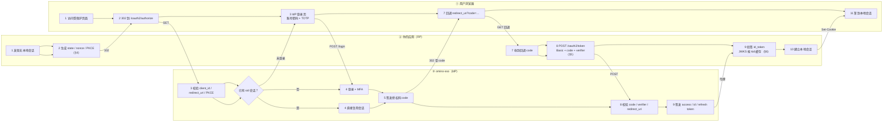
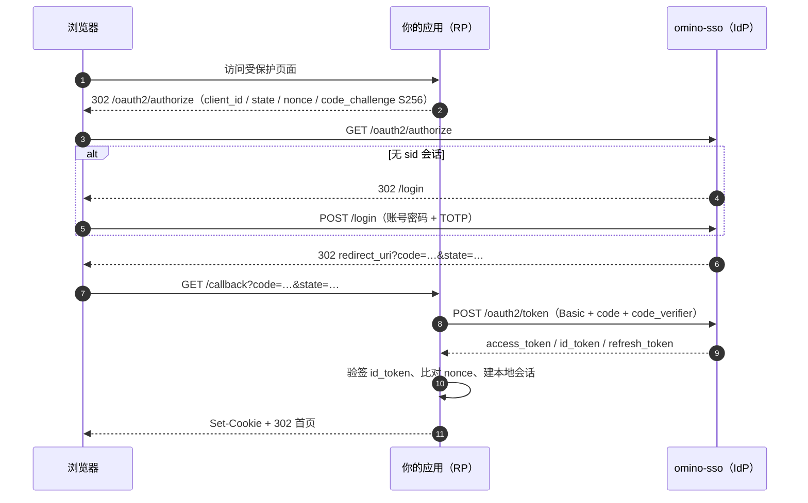

# 应用接入指南（OIDC）

> 适用对象：Java / Python / Go 等任意语言的业务系统接入 omino-sso 统一身份。
> 协议：OIDC Authorization Code + PKCE（仅 S256）。不提供 implicit / password / 设备码。

## 术语与缩写

先扫一遍这张表再读正文；后文首次出现时只给一句提示，不重复展开。

| 术语 | 全称 / 读法 | 含义 |
|---|---|---|
| **IdP** | Identity Provider，身份提供方 | 本文指 omino-sso 本身：负责登录、签发令牌、维护登录会话 |
| **RP** | Relying Party，依赖方 | 接入方系统（你的 Java / Python / Go 应用），依赖 IdP 完成认证 |
| **OIDC** | OpenID Connect | 架在 OAuth 2.0 之上的认证层，用 `id_token` 回答「这个用户是谁」 |
| **授权码** | authorization code | IdP 经浏览器发给 RP 的一次性短命凭据，只能换一次令牌 |
| **PKCE** | Proof Key for Code Exchange | 用 `code_verifier` / `code_challenge` 证明「换令牌的人就是发起授权的人」，防授权码被截获后冒用 |
| **S256** | SHA-256 | PKCE 的挑战算法：`BASE64URL(SHA256(code_verifier))`；本 IdP **只接受这一种** |
| **state** | — | RP 生成、回调时回查的随机串，防 CSRF 与响应错配 |
| **nonce** | — | RP 生成、IdP 原样写入 `id_token` 的随机串，防 `id_token` 重放 |
| **id_token** | — | JWT，回答「是谁」，含 `sub` / `nonce` / `auth_time` / 自定义声明 |
| **access_token** | — | JWT，回答「能访问什么」，用于调 `userinfo` 与业务接口 |
| **refresh_token** | — | 不透明串，用于续期；**每次使用都会轮换** |
| **JWT / JWS** | JSON Web Token / Signature | 点分三段、RS256 签名的令牌格式 |
| **JWKS** | JSON Web Key Set | 公钥集端点，RP 用它验签，须按 `kid` 缓存 |
| **issuer** | — | IdP 的唯一标识 URL（如 `https://sso.example.com`），所有令牌的 `iss` 都等于它 |
| **scope** | — | 申请访问的范围：`openid` / `profile` / `email` / `offline_access` |
| **成员** | membership | 应用与用户之间的授权关系；用户只有在某应用成员中，门户才展示该应用，且 userinfo 才会给 `app_roles` / `permissions` |
| **应用内角色** | app role | 某个应用自己的角色（如 `opsAdmin`），仅在该应用内生效，与平台 `roles` 无关 |
| **权限** | permission | 挂在应用内角色下的功能编码（如 `order:read`），经 userinfo 的 `permissions` 数组下发给接入方 |
| **claim** | — | 令牌里的字段，如 `sub`、`tenant`、`roles` |
| **sid** | session id | IdP 侧会话 cookie 名（`HttpOnly` + host-only），浏览器不会把它发给 RP |
| **MFA / TOTP** | 多因素认证 / 时间型一次性密码 | 登录第二步的 6 位动态码，由 IdP 负责，RP 无感 |
| **amr** | authentication methods references | 令牌里记录本次认证方式：`pwd` / `otp` |
| **SSO / SLO** | Single Sign-On / Single Logout | 一次登录处处通行 / 一处登出使 **IdP 会话**失效（不等于全网广播） |
| **RP 发起登出** | RP-Initiated Logout | RP 引导浏览器调 `/oauth2/end_session` 清 IdP 会话 |
| **DCR** | Dynamic Client Registration | 客户端自助注册协议，本 IdP 未实现 |
| **introspect** | Token Introspection | 把令牌交给 IdP 查询是否有效、属于谁 |

## 0. 前置条件

- omino-sso 已部署，issuer 形如 `https://sso.example.com`（`APP_ENV=prod` 时强制 https）
- 你有管理员账号（可访问 `/api/v1/admin/*` 完成应用注册）
- 你的应用（RP）有浏览器可访问的回调地址，且能保存服务端会话

## 1. 能力边界

| 支持 | 不支持（勿尝试） |
|---|---|
| `authorization_code` + PKCE(S256) | implicit、password、设备码 |
| `refresh_token`（轮换 + 重放检测） | `client_secret_post` |
| `client_secret_basic` | request object（`request` / `request_uri`） |
| `userinfo`、`introspect`、`revoke` | 动态客户端注册（DCR） |
| 单点登录 / RP 发起登出 | 注册 `post_logout_redirect_uri` |
| MFA（由 IdP 负责，RP 无感） | 会话管理 iframe 探测、SAML |
| 应用内角色与权限（userinfo 的 `app_roles` / `permissions`） | 用平台 `roles` 推导应用内权限（两者互不推导，见 §6.1） |

## 2. 端点一览

`issuer` 以 `https://sso.example.com` 为例；各端点也可从 `{issuer}/.well-known/openid-configuration` 自动发现。

| 用途 | 端点 |
|---|---|
| 元数据 | `GET {issuer}/.well-known/openid-configuration` |
| 授权 | `GET {issuer}/oauth2/authorize` |
| 令牌 | `POST {issuer}/oauth2/token`（仅 form-encoded） |
| 用户信息 | `GET {issuer}/oauth2/userinfo`（Bearer） |
| 公钥集 | `GET {issuer}/oauth2/jwks` |
| 自省 | `POST {issuer}/oauth2/introspect`（需客户端认证） |
| 撤销 | `POST {issuer}/oauth2/revoke`（需客户端认证） |
| 登出 | `GET {issuer}/oauth2/end_session` |

### 2.1 授权码流程（泳道图）

三条泳道分别是**用户浏览器**、**你的应用（RP）**、**omino-sso（IdP）**。图中数字是交互顺序，括注对应后文小节。



同一流程的消息视图（顺序更直观，便于对照抓包）：



## 3. 第一步：注册应用

由管理员调用管理 API（需 admin 会话 cookie）：

```bash
curl -b admin.cookie -X POST https://sso.example.com/api/v1/admin/clients \
  -H 'Content-Type: application/json' \
  -d '{
    "clientName": "员工门户",
    "description": "员工自助门户",
    "redirectUris": ["https://portal.example.com/callback"],
    "grantTypes": ["authorization_code", "refresh_token"],
    "scopes": ["openid", "profile", "email", "offline_access"],
    "isPublic": false
  }'
```

| 字段 | 必填 | 说明 |
|---|---|---|
| `clientName` | 是 | 1–128 字符，登录页会显示 |
| `redirectUris` | 是 | 至少一个；**逐字符精确匹配**，建议不带查询串 |
| `grantTypes` | 否 | 省略时为 `authorization_code,refresh_token` |
| `scopes` | 否 | 省略时为 `openid,profile,email,offline_access` |
| `isPublic` | 否 | `true` = 无密钥（SPA / 移动端），必须用 PKCE |

响应中的 `clientSecret` **只出现一次**，不落日志、不可再查；丢失只能轮换：

```bash
curl -b admin.cookie -X POST https://sso.example.com/api/v1/admin/clients/<clientId>/secret
```

默认时效：access_token 900 秒，refresh_token 30 天。

## 4. 第二步：发起授权

本步由**浏览器**完成跳转；你的应用（RP）只负责生成参数，并在自己的会话里暂存 `state` / `nonce` / `code_verifier`
—— 三者回调时都要比对，其中只有 `code_challenge`（= `S256(code_verifier)`）会发给 IdP。

```text
GET {issuer}/oauth2/authorize
  ?response_type=code
  &client_id=<clientId>
  &redirect_uri=<已注册的地址，逐字符一致>
  &scope=openid profile email
  &state=<随机串，回调时校验>
  &nonce=<随机串，用于校验 id_token>
  &code_challenge=<BASE64URL(SHA256(verifier))>
  &code_challenge_method=S256
```

- 未登录时 IdP 会 302 到 `/login?id=...`，登录与 MFA 都在 IdP 完成，你的应用无需实现登录页
- 用户已有 IdP 会话时**直接返回 code**，这就是单点登录
- 公开客户端（`isPublic=true`）**必须**携带 PKCE；机密客户端可选，但一旦携带只能是 `S256`
- `state` 与 `nonce` 必须存在服务端会话里，回调时逐字节比对

生成 PKCE 参数：

```bash
VERIFIER=$(openssl rand -base64 60 | tr -d '\n=+/' | cut -c1-64)
CHALLENGE=$(printf %s "$VERIFIER" | openssl dgst -binary -sha256 | openssl base64 | tr -d '=' | tr '/+' '_-')
```

## 5. 第三步：回调换令牌

本步必须在 **RP 后端**完成（密钥与令牌都不能进浏览器）。`code` 只能使用一次，且 `code_verifier` 必须与第 4 步
生成并暂存的那一个完全一致，否则 IdP 会以 `invalid_grant` 拒绝。

```text
POST {issuer}/oauth2/token
Content-Type: application/x-www-form-urlencoded
Authorization: Basic base64(client_id:client_secret)

grant_type=authorization_code
&code=<回调带回的 code>
&redirect_uri=<与授权请求完全一致>
&code_verifier=<第 4 步的 VERIFIER>
```

```json
{
  "access_token": "eyJhbGciOiJSUzI1NiIsImtpZCI6...",
  "token_type": "Bearer",
  "expires_in": 900,
  "refresh_token": "...",
  "scope": "openid profile email",
  "id_token": "eyJhbGciOiJSUzI1NiIsImtpZCI6..."
}
```

- 机密客户端**只能用 HTTP Basic** 传密钥（`client_secret_post` 不被接受）
- `refresh_token` 仅当授予的 scope 含 `offline_access` 时才有意义，请按需注册
- 错误响应遵循 RFC 6749 §5.2（`{"error":"invalid_grant","error_description":"..."}`），不套统一响应结构

## 6. 第四步：校验令牌与取用户

`id_token` 回答「是谁」，用来建你自己的会话；`access_token` 回答「能访问什么」，用来调 `userinfo` 与业务接口。
两者都是 JWT，但用途不同，不要用 `access_token` 判断身份、也不要拿 `id_token` 调接口。

1. 用 `{issuer}/oauth2/jwks` 取公钥（**按 `kid` 缓存，不要每次请求都拉**）
2. 校验 `id_token`：RS256 签名、`iss == issuer`、`aud == clientId`、`exp` / `iat`、`nonce` 与本地存的一致
3. 需要用户资料时调 `GET {issuer}/oauth2/userinfo`（Bearer access_token）
4. 或直接本地验签解 `id_token`（推荐，少一次网络往返）

### 可用声明

| claim | 出现位置 | 说明 |
|---|---|---|
| `sub` | 三处 | 用户唯一 ID（26 位 ULID），**用它做主键，不要用 username** |
| `preferred_username` | id_token / userinfo | 登录名 |
| `name` | id_token / userinfo | 显示名 |
| `email` / `email_verified` | id_token / userinfo | 有邮箱时返回，`email_verified` 恒为 `true` |
| `picture` | id_token / userinfo | 头像 URL |
| `tenant` | id_token / access_token / userinfo | 租户，默认 `default` |
| `dept_id` | id_token / userinfo | 部门 ID |
| `roles` | id_token / userinfo | 角色数组，用于权限映射 |
| `app_roles` | **仅 userinfo** | 该用户在**当前令牌所属应用**内的角色名，见 §6.1 |
| `permissions` | **仅 userinfo** | 上述角色所绑定的权限编码去重并集，见 §6.1 |
| `amr` | id_token | 认证方式：`pwd` / `otp`（含 `otp` 表示已过 MFA） |
| `auth_time` | id_token | 首次认证时间（秒级时间戳） |
| `nonce` | id_token | 原样回传授权请求的值 |

> `tenant` / `dept_id` / `roles` 三个自定义声明的**名字已冻结**，不会重命名。`app_roles` / `permissions` 是 2026-10 新增，**只出现在 userinfo**，不进入 `id_token`（避免令牌体积膨胀、影响既有接入方）。

### 6.1 应用内角色与权限（userinfo 专属）

`roles` 与 `app_roles` 是两套互不相干的东西：

| | `roles`（平台角色） | `app_roles`（应用内角色） |
|---|---|---|
| 归属 | 用户，跨应用统一 | 单个应用内 |
| 来源 | `users.roles`，管理员维护 | 管理后台「应用角色」，按应用维护 |
| 语义 | 平台内部权限，已冻结 | 接入方做**应用内**功能鉴权 |
| 互不推导 | 不会出现在 `app_roles` | `admin` 不会自动获得任何 `app_roles` |

示例 userinfo 响应：

```json
{
  "sub": "01J9ZJ8Q2M4N6P8R0T2V4X6Z8A",
  "preferred_username": "zhangsan",
  "roles": ["user"],
  "app_roles": ["opsAdmin", "viewer"],
  "permissions": ["order:read", "order:write"]
}
```

要点：

- `permissions` 是 `app_roles` 绑定权限的**去重并集**，已按编码升序；`app_roles` 按名字升序。
- 两个字段**永远是数组**：用户非成员、成员但无角色、或历史令牌查不到映射时，均为 `[]`，不会是 `null`、也不会省略。
- **即时生效**：成员被移除、角色/权限解绑、角色改名后，下一次 `userinfo` 立即反映，服务端不做缓存。
- **按令牌所属应用隔离**：同一用户用 A 应用的令牌调 userinfo，拿到的是 A 的 `app_roles`；换 B 应用令牌就是 B 的。
- **不要用 scope 推导 `permissions`**，反之亦然：scope 决定"这次能拿哪些 claim"，`permissions` 描述"在本应用能做什么"。权限编码允许 `:`、`.` 只是可读性，不代表 scope 命名空间。
- 应用门户可见性也是成员制的：用户只有被加入某应用成员后，才会在自己的应用列表中看到它。

三语言取用示例（完整工程见 §9）：

```java
// Java：标准 OIDC claim 直接读
@AuthenticationPrincipal OidcUser user;
List<String> appRoles = user.getAttribute("app_roles");   // 可能为 []
List<String> perms    = user.getAttribute("permissions"); // 可能为 []
```

```python
# Python：authlib 返回 dict
userinfo = oauth.parse_id_token(...)  # 或 /userinfo 的 JSON
app_roles = userinfo.get("app_roles", [])
perms     = userinfo.get("permissions", [])
```

```go
// Go：go-oidc 的 claims 结构体
var c struct {
    AppRoles    []string `json:"app_roles"`
    Permissions []string `json:"permissions"`
}
_ = verifier.Verify(ctx, rawIDToken) // 但这两个字段只来自 userinfo，见下
// 从 userinfo 端点取：provider.UserInfo(ctx, oauth2.StaticTokenSource(token))
```

> 注意：因为 `app_roles` / `permissions` **不进 id_token**，Java/Python 的 `id_token` 解析拿不到它们；必须调一次 `userinfo`（或在 Spring Security 里配置 `OidcUserService` 的 userinfo 加载，框架默认就会带）。Go 的 `go-oidc` 需要显式用 `provider.UserInfo(...)`。

## 7. 第五步：刷新令牌

```text
POST {issuer}/oauth2/token
Authorization: Basic ...
Content-Type: application/x-www-form-urlencoded

grant_type=refresh_token&refresh_token=<旧 token>&client_id=<clientId>
```

- **每次刷新都会轮换**：旧 refresh_token 立即失效，返回新的
- **重放检测**：已失效的 refresh_token 若被再次使用，整条令牌族被吊销，用户被强制重新登录
- 因此**必须单飞刷新**：同一用户的并发刷新要用互斥锁或 singleflight 合并，否则会互相踢下线
- 可将 `scope` 缩小到原授予集合的子集，不能扩大

## 8. 第六步：登出

分三层，按需组合：

| 层 | 做法 | 实际效果 |
|---|---|---|
| RP 本地会话 | 清你自己的 session / cookie | 只影响你自己的系统 |
| IdP 会话（RP 发起） | `GET /oauth2/end_session` | **只吊销该 client 的 refresh_token**，`sid` 仍存活 |
| 清 IdP 会话并回跳 | `GET /logout?next=/logged-out` | 真正删除 `sid` 会话，跳到同源相对路径 |

```text
# ① 标准姿势（RP 发起登出），注意它目前不清 sid
GET {issuer}/oauth2/end_session?id_token_hint=<id_token>&state=<随机串>

# ② 真正清 IdP 会话（omino-sso 自有端点，next 只接受同源相对路径）
GET {issuer}/logout?next=/logged-out
```

三点必须知道：

1. **`end_session` 目前不清 `sid`**：服务端 `TerminateSession(userID, clientID)` 仅在 `clientID` 为空时删除会话；而带 `id_token_hint` 时 `clientID` 必然非空（取自 `azp`），因此只吊销该客户端的 refresh_token。要真正登出 IdP，请调 `/logout`。
2. **`post_logout_redirect_uri` 一律不可用**：客户端 `post_logout_uris` 恒为空（注册接口未开放该字段）。带 `client_id` 再传该参数会被拒为 **`400 invalid_request: post_logout_redirect_uri invalid`**；不带 `client_id` 时该参数被忽略，落到 `/logged-out`。要回到自己的站点，让前端从 `/logged-out` 再跳一次。
3. **SLO 语义**：`/logout` 只失效 **IdP 会话**，不广播到其他系统；其他 RP 的本地会话各自到期。若要求「一处登出、处处失效」，需新增 back-channel logout（属 L2 改造）。

## 9. 三语言完整示例

### 9.0 先对齐：三个语言暴露同一组端点

不管用什么框架，接入后对外只有这四个端点。下文三个工程**路径完全一致**，方便横向对照或换语言重写：

| 端点 | 作用 | 谁调用 |
|---|---|---|
| `GET /login` | 生成 state / nonce / PKCE，302 到 IdP 授权端点 | 页面上的「登录」按钮 |
| `GET /callback` | 校验 state，用 code 换令牌，建本地会话 | IdP 回调 |
| `GET /api/me` | 返回当前用户；未登录返回 401 | 前端页面 |
| `GET /logout` | 清本地会话，再跳 IdP `/logout` 清 IdP 会话 | 页面上的「登出」按钮 |

除此之外你不需要写任何协议代码：授权 URL 拼接、令牌交换、`id_token` 验签、JWKS 拉取与缓存，全部由库完成。
每段示例后面都标了**注册应用时该填的 `redirectUris`**，这一项填错是最常见的失败原因。

### 9.1 Java（Spring Boot 3 + Spring Security）

工程结构（5 个文件）：

```text
demo-java/
├── pom.xml
└── src/main/
    ├── java/com/example/demo/
    │   ├── DemoApplication.java
    │   ├── SecurityConfig.java
    │   └── AuthController.java
    └── resources/application.yaml
```

**① `pom.xml`**

```xml
<?xml version="1.0" encoding="UTF-8"?>
<project xmlns="http://maven.apache.org/POM/4.0.0"
         xmlns:xsi="http://www.w3.org/2001/XMLSchema-instance"
         xsi:schemaLocation="http://maven.apache.org/POM/4.0.0 https://maven.apache.org/xsd/maven-4.0.0.xsd">
  <modelVersion>4.0.0</modelVersion>

  <parent>
    <groupId>org.springframework.boot</groupId>
    <artifactId>spring-boot-starter-parent</artifactId>
    <version>3.2.5</version>
    <relativePath/>
  </parent>

  <groupId>com.example</groupId>
  <artifactId>sso-demo</artifactId>
  <version>1.0.0</version>

  <properties>
    <java.version>17</java.version>
  </properties>

  <dependencies>
    <!-- Web + 内嵌 Tomcat -->
    <dependency>
      <groupId>org.springframework.boot</groupId>
      <artifactId>spring-boot-starter-web</artifactId>
    </dependency>
    <!-- OIDC 登录：授权跳转、回调换令牌、id_token 验签、JWKS 缓存全部内置 -->
    <dependency>
      <groupId>org.springframework.boot</groupId>
      <artifactId>spring-boot-starter-oauth2-client</artifactId>
    </dependency>
  </dependencies>

  <build>
    <plugins>
      <plugin>
        <groupId>org.springframework.boot</groupId>
        <artifactId>spring-boot-maven-plugin</artifactId>
      </plugin>
    </plugins>
  </build>
</project>
```

只需两个依赖：`oauth2-client` 已传递引入 `spring-boot-starter-security`，无需重复声明，也不需要 Thymeleaf。

**② `src/main/resources/application.yaml`**

```yaml
server:
  port: 8000
  servlet:
    session:
      cookie:
        name: DEMO_SESSION
        http-only: true
        same-site: lax

spring:
  security:
    oauth2:
      client:
        registration:
          omino:
            client-id: ${SSO_CLIENT_ID}
            client-secret: ${SSO_CLIENT_SECRET}
            client-name: 统一身份
            authorization-grant-type: authorization_code
            # 默认回调地址由 {registrationId} 决定：http://localhost:8000/login/oauth2/code/omino
            redirect-uri: "{baseUrl}/login/oauth2/code/{registrationId}"
            scope: openid,profile,email
            # 本 IdP 的机密客户端只接受 HTTP Basic，必须显式声明
            client-authentication-method: client_secret_basic
        provider:
          omino:
            issuer-uri: ${SSO_ISSUER}      # 例：https://sso.example.com
```

> `{baseUrl}` 与 `{registrationId}` 是 Spring Security 的 URI 模板占位符，**不需要在配置里定义**：前者在发起登录时
> 用当前请求的 `scheme://host:port`（有 context-path 时含前缀）展开，后者取 registration id（这里是 `omino`）。
> 本地展开为 `http://localhost:8000/login/oauth2/code/omino`，生产展开为 `https://app.example.com/login/oauth2/code/omino`。
> 这一行本身也可以省略 —— Spring Boot 的默认值就是这串模板。
>
> 真正的坑在**反向代理**：服务在 Nginx / 负载均衡后面终止 TLS 时，Spring 可能推导出 `http://` 或内网主机名，
> 与注册值不一致就会被 IdP 拒绝。解决：加 `server.forward-headers-strategy: framework`（让 Spring 读取
> `X-Forwarded-*`），或干脆把 `redirect-uri` 写成绝对地址。
>
> `${SSO_ISSUER}` / `${SSO_CLIENT_ID}` / `${SSO_CLIENT_SECRET}` 同理是占位符，由环境变量在启动时注入
> （见下方「⑥ 运行」），不必写进 `application.yaml`，也**不要把密钥提交进取值**。

**③ `DemoApplication.java`**

```java
package com.example.demo;

import org.springframework.boot.SpringApplication;
import org.springframework.boot.autoconfigure.SpringBootApplication;

@SpringBootApplication
public class DemoApplication {
    public static void main(String[] args) {
        SpringApplication.run(DemoApplication.class, args);
    }
}
```

**④ `SecurityConfig.java`**

```java
package com.example.demo;

import org.springframework.beans.factory.annotation.Value;
import org.springframework.context.annotation.Bean;
import org.springframework.context.annotation.Configuration;
import org.springframework.security.config.annotation.web.builders.HttpSecurity;
import org.springframework.security.config.annotation.web.configuration.EnableWebSecurity;
import org.springframework.security.oauth2.client.registration.ClientRegistrationRepository;
import org.springframework.security.oauth2.client.web.DefaultOAuth2AuthorizationRequestResolver;
import org.springframework.security.oauth2.client.web.OAuth2AuthorizationRequestCustomizers;
import org.springframework.security.oauth2.client.web.OAuth2AuthorizationRequestRedirectFilter;
import org.springframework.security.web.SecurityFilterChain;
import org.springframework.security.web.authentication.SimpleUrlLogoutSuccessHandler;
import org.springframework.security.web.util.matcher.AntPathRequestMatcher;

@Configuration
@EnableWebSecurity
public class SecurityConfig {

    @Bean
    SecurityFilterChain filterChain(HttpSecurity http,
                                    ClientRegistrationRepository repo,
                                    SimpleUrlLogoutSuccessHandler idpLogoutHandler) throws Exception {
        // 授权请求：默认走 /oauth2/authorization/omino，这里只额外挂上 PKCE
        var resolver = new DefaultOAuth2AuthorizationRequestResolver(
                repo, OAuth2AuthorizationRequestRedirectFilter.DEFAULT_AUTHORIZATION_REQUEST_BASE_URI);
        // 本 IdP 允许机密客户端不带 PKCE，但带上就必须是 S256；显式开启更稳妥
        resolver.setAuthorizationRequestCustomizer(OAuth2AuthorizationRequestCustomizers.withPkce());

        http
            .authorizeHttpRequests(auth -> auth
                .requestMatchers("/", "/error", "/logged-out").permitAll()
                .anyRequest().authenticated())
            .oauth2Login(login -> login
                .authorizationEndpoint(ep -> ep.authorizationRequestResolver(resolver)))
            // 登出：先清本地会话，再跳 IdP 的 /logout（本 IdP 的 end_session 不清 sid，见 §8）
            .logout(logout -> logout
                .logoutRequestMatcher(new AntPathRequestMatcher("/logout", "GET"))
                .logoutSuccessHandler(idpLogoutHandler)
                .invalidateHttpSession(true)
                .deleteCookies("DEMO_SESSION"));
        return http.build();
    }

    @Bean
    SimpleUrlLogoutSuccessHandler idpLogoutHandler(@Value("${SSO_ISSUER}") String issuer) {
        var handler = new SimpleUrlLogoutSuccessHandler();
        // next 只接受同源相对路径；要回跳本系统，需前端从 /logged-out 再跳一次
        handler.setDefaultTargetUrl(issuer + "/logout?next=/logged-out");
        return handler;
    }
}
```

> IDE 若提示 `OAuth2AuthorizationRequestCustomizers` 找不到，安全起见让它自动导入（Security 6.2+ 提供，包名为
> `org.springframework.security.oauth2.client.web`）。演示用 `GET /logout` 是为了便于在地址栏验证；
> 生产环境建议去掉 `logoutRequestMatcher` 那行，恢复 Spring 默认的 `POST /logout` + CSRF 校验。

**⑤ `AuthController.java`**

```java
package com.example.demo;

import java.util.LinkedHashMap;
import java.util.Map;
import org.springframework.beans.factory.annotation.Value;
import org.springframework.security.core.annotation.AuthenticationPrincipal;
import org.springframework.security.oauth2.client.OAuth2AuthorizedClient;
import org.springframework.security.oauth2.client.annotation.RegisteredOAuth2AuthorizedClient;
import org.springframework.security.oauth2.core.oidc.user.OidcUser;
import org.springframework.web.bind.annotation.GetMapping;
import org.springframework.web.bind.annotation.RestController;
import org.springframework.web.client.RestClient;

@RestController
public class AuthController {

    private final String issuer;
    private final RestClient http = RestClient.create();

    public AuthController(@Value("${SSO_ISSUER}") String issuer) {
        this.issuer = issuer;
    }

    @GetMapping("/")
    public Map<String, Object> home(@AuthenticationPrincipal OidcUser user) {
        Map<String, Object> body = new LinkedHashMap<>();
        body.put("loggedIn", user != null);
        body.put("user", user == null ? null : user.getClaimAsString("preferred_username"));
        body.put("try", new String[] {"/api/me", "/api/userinfo"});
        return body;
    }

    // 只读 id_token 里的声明，无网络调用 —— 建本地会话、做鉴权都用这个
    @GetMapping("/api/me")
    public Map<String, Object> me(@AuthenticationPrincipal OidcUser user) {
        Map<String, Object> body = new LinkedHashMap<>();
        body.put("sub", user.getSubject());
        body.put("username", user.getClaimAsString("preferred_username"));
        body.put("name", user.getFullName());
        body.put("email", user.getEmail());            // 未填邮箱时为 null
        body.put("tenant", user.getClaimAsString("tenant"));
        body.put("deptId", user.getClaimAsString("dept_id"));
        body.put("roles", user.getClaimAsStringList("roles"));
        body.put("amr", user.getClaimAsStringList("amr")); // 含 otp 表示过了 MFA
        return body;
    }

    // 演示用 access_token 调 userinfo（只有在需要「最新资料」时才必要）
    @GetMapping("/api/userinfo")
    public String userinfo(@RegisteredOAuth2AuthorizedClient("omino") OAuth2AuthorizedClient client) {
        return http.get()
                .uri(issuer + "/oauth2/userinfo")
                .header("Authorization", "Bearer " + client.getAccessToken().getTokenValue())
                .retrieve()
                .body(String.class);
    }

    @GetMapping("/logged-out")
    public String loggedOut() {
        return "已登出 IdP 会话，可直接关闭本页。";
    }
}
```

**⑥ 运行**

```bash
export SSO_ISSUER=https://sso.example.com
export SSO_CLIENT_ID=<clientId>
export SSO_CLIENT_SECRET=<clientSecret>
mvn spring-boot:run
# 浏览器打开 http://localhost:8000/ → 自动跳 IdP 登录 → 回到 /api/me
```

注册应用时填：`redirectUris = ["http://localhost:8000/login/oauth2/code/omino"]`。

### 9.2 Python（FastAPI + Authlib）

工程结构（3 个文件）：

```text
demo-python/
├── requirements.txt
├── app.py
└── .env            # 可选，用 export 也一样
```

**① `requirements.txt`**

```text
fastapi==0.115.6
uvicorn[standard]==0.34.0
authlib==1.4.1
httpx==0.28.1
itsdangerous==2.2.0
```

`authlib` 负责协议，`httpx` 用于发现文档与调 `userinfo`，`itsdangerous` 是会话中间件的依赖。

**② `app.py`**

```python
import os
import secrets

import httpx
from authlib.integrations.starlette_client import OAuth
from fastapi import FastAPI, Request
from fastapi.responses import JSONResponse, RedirectResponse
from starlette.middleware.sessions import SessionMiddleware

ISSUER = os.environ["SSO_ISSUER"].rstrip("/")
CLIENT_ID = os.environ["SSO_CLIENT_ID"]
CLIENT_SECRET = os.environ["SSO_CLIENT_SECRET"]
SESSION_SECRET = os.environ.get("SESSION_SECRET", secrets.token_urlsafe(32))

app = FastAPI()
# 必须：state / nonce / code_verifier / 用户信息都存这里，且要签名
app.add_middleware(
    SessionMiddleware,
    secret_key=SESSION_SECRET,
    same_site="lax",
    https_only=False,      # 生产改 True
)

oauth = OAuth()
oauth.register(
    name="omino",
    client_id=CLIENT_ID,
    client_secret=CLIENT_SECRET,
    server_metadata_url=f"{ISSUER}/.well-known/openid-configuration",  # 端点自动发现
    client_kwargs={
        "scope": "openid profile email",
        "code_challenge_method": "S256",   # Authlib 自动生成 verifier 并存进 session
    },
)


@app.get("/login")
async def login(request: Request):
    redirect_uri = str(request.url_for("callback"))   # 必须与注册值逐字符一致
    nonce = secrets.token_urlsafe(16)
    return await oauth.omino.authorize_redirect(request, redirect_uri, nonce=nonce)


@app.get("/callback")
async def callback(request: Request):
    # 校验 state 与 id_token 签名；PKCE 用 session 里的 verifier 完成
    token = await oauth.omino.authorize_access_token(request)
    request.session["user"] = dict(token.get("userinfo") or {})
    request.session["access_token"] = token.get("access_token")
    return RedirectResponse("/api/me")


@app.get("/api/me")
async def me(request: Request):
    user = request.session.get("user")
    if not user:
        return JSONResponse({"error": "unauthenticated"}, status_code=401)
    return {
        "sub": user.get("sub"),
        "username": user.get("preferred_username"),
        "name": user.get("name"),
        "email": user.get("email"),
        "tenant": user.get("tenant"),
        "deptId": user.get("dept_id"),
        "roles": user.get("roles", []),
        "amr": user.get("amr", []),
    }


@app.get("/api/userinfo")
async def userinfo(request: Request):
    token = request.session.get("access_token")
    if not token:
        return JSONResponse({"error": "unauthenticated"}, status_code=401)
    async with httpx.AsyncClient(timeout=5) as client:
        resp = await client.get(
            f"{ISSUER}/oauth2/userinfo",
            headers={"Authorization": f"Bearer {token}"},
        )
    return JSONResponse(resp.json(), status_code=resp.status_code)


@app.get("/logout")
async def logout(request: Request):
    request.session.clear()
    # 本 IdP 的 end_session 不清 sid，必须用 /logout
    return RedirectResponse(f"{ISSUER}/logout?next=/logged-out")
```

**③ 运行**

```bash
pip install -r requirements.txt
export SSO_ISSUER=https://sso.example.com
export SSO_CLIENT_ID=<clientId>
export SSO_CLIENT_SECRET=<clientSecret>
uvicorn app:app --port 8000
```

注册应用时填：`redirectUris = ["http://localhost:8000/callback"]`。

两点补充：

- `nonce` 已随授权请求发出、IdP 会原样写回 `id_token`。若你的 Authlib 版本未自动比对，可在回调里自行取
  `token["userinfo"]["nonce"]` 与会话中的值比较一次。
- Django 项目可用 `mozilla-django-oidc`，四个等价配置：`OIDC_RP_SIGN_ALGO=RS256`、`OIDC_OP_ISSUER`、
  `OIDC_RP_CLIENT_ID` / `OIDC_RP_CLIENT_SECRET`。

### 9.3 Go（标准库 + `x/oauth2` + `go-oidc`）

工程结构（2 个文件）：

```text
demo-go/
├── go.mod
└── main.go
```

**① 依赖**

```bash
go mod init demo
go get github.com/coreos/go-oidc/v3/oidc
go get golang.org/x/oauth2
go get github.com/gorilla/sessions
```

**② `main.go`**

```go
package main

import (
	"context"
	"crypto/rand"
	"crypto/sha256"
	"encoding/base64"
	"encoding/json"
	"fmt"
	"log"
	"net/http"
	"os"

	"github.com/coreos/go-oidc/v3/oidc"
	"github.com/gorilla/sessions"
	"golang.org/x/oauth2"
)

var (
	issuer       = os.Getenv("SSO_ISSUER")
	clientID     = os.Getenv("SSO_CLIENT_ID")
	clientSecret = os.Getenv("SSO_CLIENT_SECRET")
	callbackURL  = os.Getenv("SSO_CALLBACK") // http://localhost:8000/callback
)

var (
	store    *sessions.CookieStore
	verifier *oidc.IDTokenVerifier
	conf     *oauth2.Config
)

func main() {
	ctx := context.Background()
	// 自动发现各端点，并把 JWKS 拉进内存缓存
	provider, err := oidc.NewProvider(ctx, issuer)
	if err != nil {
		log.Fatalf("discovery: %v", err)
	}

	verifier = provider.Verifier(&oidc.Config{ClientID: clientID})
	conf = &oauth2.Config{
		ClientID:     clientID,
		ClientSecret: clientSecret,
		Endpoint:     provider.Endpoint(),
		RedirectURL:  callbackURL,
		Scopes:       []string{"openid", "profile", "email"},
	}

	store = sessions.NewCookieStore([]byte(os.Getenv("SESSION_SECRET")))
	store.Options = &sessions.Options{
		Path: "/", HttpOnly: true, SameSite: http.SameSiteLaxMode, MaxAge: 3600,
	}

	http.HandleFunc("/login", handleLogin)
	http.HandleFunc("/callback", handleCallback)
	http.HandleFunc("/api/me", handleMe)
	http.HandleFunc("/logout", handleLogout)

	log.Println("listening on :8000")
	log.Fatal(http.ListenAndServe(":8000", nil))
}

// /login：生成 state + nonce + PKCE，302 到授权端点
func handleLogin(w http.ResponseWriter, r *http.Request) {
	state, nonce, codeVerifier := randString(32), randString(16), randString(32)

	sess, _ := store.Get(r, "sso")
	sess.Values["state"] = state
	sess.Values["nonce"] = nonce
	sess.Values["verifier"] = codeVerifier
	_ = sess.Save(r, w)

	authURL := conf.AuthCodeURL(state,
		oauth2.SetAuthURLParam("nonce", nonce),
		oauth2.SetAuthURLParam("code_challenge", s256(codeVerifier)),
		oauth2.SetAuthURLParam("code_challenge_method", "S256"),
	)
	http.Redirect(w, r, authURL, http.StatusFound)
}

// /callback：校验 state → 换令牌（带 verifier）→ 验签 id_token → 建本地会话
func handleCallback(w http.ResponseWriter, r *http.Request) {
	sess, _ := store.Get(r, "sso")
	if r.URL.Query().Get("state") != sess.Values["state"] {
		http.Error(w, "state mismatch", http.StatusBadRequest)
		return
	}

	tok, err := conf.Exchange(r.Context(), r.URL.Query().Get("code"),
		oauth2.SetAuthURLParam("code_verifier", sess.Values["verifier"].(string)))
	if err != nil {
		http.Error(w, "exchange: "+err.Error(), http.StatusBadGateway)
		return
	}

	raw, _ := tok.Extra("id_token").(string)
	idToken, err := verifier.Verify(r.Context(), raw) // 校验签名 / iss / aud / exp
	if err != nil {
		http.Error(w, "verify: "+err.Error(), http.StatusUnauthorized)
		return
	}

	var claims map[string]any
	if err := idToken.Claims(&claims); err != nil {
		http.Error(w, "claims: "+err.Error(), http.StatusInternalServerError)
		return
	}
	if claims["nonce"] != sess.Values["nonce"] {
		http.Error(w, "nonce mismatch", http.StatusUnauthorized)
		return
	}

	// 只存原始 id_token，避免把任意 map 塞进 cookie（gob 类型注册的坑）
	sess.Values["id_token"] = raw
	sess.Values["access_token"] = tok.AccessToken
	delete(sess.Values, "state")
	delete(sess.Values, "nonce")
	delete(sess.Values, "verifier")
	_ = sess.Save(r, w)

	http.Redirect(w, r, "/api/me", http.StatusFound)
}

// /api/me：每次从会话里的 id_token 解声明（只查本地缓存，不产生网络请求）
func handleMe(w http.ResponseWriter, r *http.Request) {
	sess, _ := store.Get(r, "sso")
	raw, ok := sess.Values["id_token"].(string)
	if !ok {
		writeJSON(w, http.StatusUnauthorized, map[string]any{"error": "unauthenticated"})
		return
	}
	idToken, err := verifier.Verify(r.Context(), raw)
	if err != nil {
		writeJSON(w, http.StatusUnauthorized, map[string]any{"error": "invalid session"})
		return
	}

	var c struct {
		Sub      string   `json:"sub"`
		Username string   `json:"preferred_username"`
		Name     string   `json:"name"`
		Email    string   `json:"email"`
		Tenant   string   `json:"tenant"`
		DeptID   string   `json:"dept_id"`
		Roles    []string `json:"roles"`
		AMR      []string `json:"amr"`
	}
	if err := idToken.Claims(&c); err != nil {
		writeJSON(w, http.StatusInternalServerError, map[string]any{"error": "claims"})
		return
	}
	writeJSON(w, http.StatusOK, map[string]any{
		"sub": c.Sub, "username": c.Username, "name": c.Name, "email": c.Email,
		"tenant": c.Tenant, "deptId": c.DeptID, "roles": c.Roles, "amr": c.AMR,
	})
}

// /logout：先清本地会话，再清 IdP 会话
func handleLogout(w http.ResponseWriter, r *http.Request) {
	sess, _ := store.Get(r, "sso")
	sess.Options = &sessions.Options{Path: "/", MaxAge: -1} // 覆盖为立即过期
	_ = sess.Save(r, w)
	http.Redirect(w, r, fmt.Sprintf("%s/logout?next=/logged-out", issuer), http.StatusFound)
}

func writeJSON(w http.ResponseWriter, status int, body any) {
	w.Header().Set("Content-Type", "application/json; charset=utf-8")
	w.WriteHeader(status)
	_ = json.NewEncoder(w).Encode(body)
}

func randString(n int) string {
	b := make([]byte, n)
	_, _ = rand.Read(b)
	return base64.RawURLEncoding.EncodeToString(b)
}

func s256(v string) string {
	sum := sha256.Sum256([]byte(v))
	return base64.RawURLEncoding.EncodeToString(sum[:])
}
```

**③ 运行**

```bash
export SSO_ISSUER=https://sso.example.com   # 结尾不要带 /
export SSO_CLIENT_ID=<clientId>
export SSO_CLIENT_SECRET=<clientSecret>
export SSO_CALLBACK=http://localhost:8000/callback
export SESSION_SECRET=$(openssl rand -base64 32)
go run .
```

注册应用时填：`redirectUris = ["http://localhost:8000/callback"]`。

### 9.4 三语言对照

| 关注点 | Java | Python | Go |
|---|---|---|---|
| 回调路径（**框架默认**，注册时照填） | `/login/oauth2/code/omino` | `/callback` | `/callback` |
| 发起登录 | 库内置 `/oauth2/authorization/omino` | `authorize_redirect()` | `conf.AuthCodeURL()` |
| state / nonce 存放 | Security 自动 | `SessionMiddleware` | `gorilla/sessions` |
| PKCE | `withPkce()` | `code_challenge_method` | `SetAuthURLParam` 手写 |
| 换令牌 | 自动 | `authorize_access_token()` | `conf.Exchange()` |
| id_token 验签 | 自动 | 自动 | `verifier.Verify()` |
| 取声明 | `OidcUser.getClaimAsString()` | `token["userinfo"]` | `idToken.Claims()` |
| 登出 | `logoutSuccessHandler` | `RedirectResponse` | `http.Redirect` |

> **为什么回调路径三栏不一样**：这不是协议差异。回调地址是注册时自己登记的白名单，IdP 只做逐字符匹配，填什么都可以。
> Java 的 `/login/oauth2/code/omino` 是 Spring Security 过滤器 `OAuth2LoginAuthenticationFilter` 的固定入口
> （`{registrationId}` 后缀用于区分多个 registration）；Python / Go 的 `/callback` 只是我们自己的路由函数。
>
> 想把 Java 也统一成 `/callback`，两处必须同时改，否则 code 会打到 404：
> `application.yaml` 的 `redirect-uri: "{baseUrl}/callback"` + `.oauth2Login(o -> o.redirectionEndpoint(e -> e.baseUri("/callback")))`。
> 多客户端场景不建议统一 —— `{registrationId}` 后缀正是为了避免多个 registration 抢同一路径。

## 10. 十一个硬性差异点

| # | 事实 | 你会遇到的报错 |
|---|---|---|
| 1 | 只支持 `S256`，`plain` 被拒 | `code_challenge_method must be S256` |
| 2 | 公开客户端必须 PKCE | 授权请求被拒 |
| 3 | 机密客户端只能用 Basic | `401 invalid_client` |
| 4 | `redirect_uri` 逐字符精确匹配 | `invalid_grant` |
| 5 | scope 必须在注册白名单内 | `invalid_scope` |
| 6 | refresh 轮换 + 重放吊销整族 | 用户突然被强制重登 |
| 7 | access_token 是 JWT，无状态，撤销无效 | 撤销后仍能用到过期 |
| 8 | `post_logout_redirect_uri` 不可注册 | 带 `client_id` 时 `400 invalid_request` |
| 9 | 自定义 claim 固定为三个且已冻结 | 改名会破坏所有下游 |
| 10 | `app_roles` / `permissions` 只出现在 userinfo，不进 id_token | 用 id_token 解析拿不到，须调 userinfo |
| 11 | 应用内角色与平台 `roles` 互不推导 | 想用 `admin` 免配应用角色会落空 |

## 11. 错误码排错

| HTTP | `error` | 常见根因 |
|---|---|---|
| 400 | `invalid_request` | 参数缺失 / 重复；Content-Type 不是 form |
| 400 | `invalid_grant` | code 过期或已用；`redirect_uri` 不一致；`code_verifier` 不匹配；refresh 重放 |
| 400 | `invalid_scope` | 请求了未注册的 scope |
| 400 | `unsupported_grant_type` | 用了 `password` / `implicit` 等 |
| 401 | `invalid_client` | 密钥错；把 secret 放在 body（应放 Basic）；客户端被禁用 |

## 12. 端到端自检

```bash
ISSUER=https://sso.example.com
CID=<clientId>; SECRET=<clientSecret>; REDIRECT=https://portal.example.com/callback

VERIFIER=$(openssl rand -base64 60 | tr -d '\n=+/' | cut -c1-64)
CHALLENGE=$(printf %s "$VERIFIER" | openssl dgst -binary -sha256 | openssl base64 | tr -d '=' | tr '/+' '_-')

# 1) 授权：应 302 到 /login?id=...
curl -si "$ISSUER/oauth2/authorize?response_type=code&client_id=$CID\
&redirect_uri=$REDIRECT&scope=openid%20profile%20email&state=s1&nonce=n1\
&code_challenge=$CHALLENGE&code_challenge_method=S256" | grep -i '^location'

# 2) 浏览器完成登录，从回调地址取 code，然后换令牌
curl -s -u "$CID:$SECRET" -X POST "$ISSUER/oauth2/token" \
  -d grant_type=authorization_code -d code="$CODE" \
  -d redirect_uri="$REDIRECT" -d code_verifier="$VERIFIER"

# 3) 取用户信息
curl -s -H "Authorization: Bearer $ACCESS_TOKEN" "$ISSUER/oauth2/userinfo"
```

## 13. 需要 IdP 侧改造时

以下需求**不属于接入方范围内**，需在 omino-sso 仓库按 L2 流程立项：

1. 开放 `postLogoutUris` 注册（当前硬编码为空）
2. 支持 `client_secret_post`
3. Back-channel logout（真正的一处登出、处处失效）
4. 动态客户端注册（DCR）
5. SAML / 其他协议
